# Diseño de la base de datos

**Proyecto**: Diamante Barbería · **Motor**: PostgreSQL 18 · **Versión del documento**: 1.0 (18/11/2026)

El script ejecutable está en [esquema.sql](esquema.sql). Se probó sobre PostgreSQL 18.6: se aplica sin errores, pasa 27 pruebas de reglas de negocio y responde las consultas críticas en milisegundos con cinco años de datos simulados (sección 9).

---

## 1. Principios de diseño

| Principio | Cómo se aplica |
|---|---|
| **Un esquema por módulo** | Cada módulo del backend tiene su esquema de PostgreSQL (`agenda`, `ventas`, `barberos`…). La organización del código se ve también en la base de datos. |
| **Un dueño por tabla** | Solo el módulo dueño escribe en sus tablas. Los demás leen a través de su API pública o de sus **vistas publicadas** (prefijo `v_`), que son su contrato de lectura. Se permiten llaves foráneas entre esquemas para no perder integridad. |
| **Tercera forma normal** | Ningún dato derivable se guarda (subtotal, total, comisión, diferencia de caja, estado del barbero, horario de atención, segmento). Las excepciones son deliberadas y están en la sección 3. |
| **Integridad en la base de datos** | Las reglas que no pueden fallar se garantizan con restricciones y no solo en el código: no solapamiento de citas, cuadre de ventas, subtipos de usuario, combos, auditoría de solo inserción. |
| **Tiempo controlado por la aplicación** | Las funciones que dependen de «hoy» reciben la fecha como parámetro, para que las pruebas puedan fijar el reloj. |
| **Nada se borra físicamente** | Barberos, servicios, clientes, citas y ventas se desactivan, se anulan o se anonimizan. |

## 2. Tipos y convenciones

| Tema | Decisión | Motivo |
|---|---|---|
| Llaves primarias | `bigint GENERATED ALWAYS AS IDENTITY` (`smallint` en catálogos pequeños) | Compactas (8 bytes), con buena localidad en los índices y joins rápidos. Los identificadores públicos de enlaces no son los IDs: son tokens aleatorios guardados como hash. |
| Dinero | Dominio `nucleo.dinero` = `bigint ≥ 0`, en pesos | Sin decimales de punto flotante (RNF-INT-03). |
| Porcentajes | Dominio `nucleo.porcentaje` = `numeric(5,2)` entre 0 y 100 | Exacto. |
| Celular | Dominio `nucleo.celular_co`: 10 dígitos que empiezan por 3, sin +57 | Una sola validación para todos los módulos (RNF-LOC-03). |
| Correo | Dominio `nucleo.correo` sobre `citext` | Único sin importar mayúsculas. |
| Fechas y horas | `timestamptz` para instantes; `date` para fechas; `time` para franjas semanales | Se guardan en UTC y se presentan en America/Bogota (RNF-INT-04). |
| Estados y listas cerradas | Tipos `ENUM` de PostgreSQL, uno por esquema | 4 bytes, legibles y mapeados a `enum` de Rust con SQLx. Las listas que administra el usuario (métodos de pago, descuentos, categorías) son tablas. |
| Rangos | `tstzrange`, `daterange` y el rango propio `nucleo.rango_hora` | Permiten restricciones `EXCLUDE` contra solapes. |
| Nombres | Español, `snake_case`, tablas en singular; restricciones con sufijo `_uk`, `_fk`, `_ck`, índices `_idx` | Coherencia con el código. |
| Auditoría de filas | `creado_en` y `actualizado_en`, este último mantenido por el trigger `nucleo.tocar_actualizado_en()` | No depende de que el código lo recuerde. |

Extensiones: `btree_gist` (exclusiones con columnas escalares), `citext`, `pg_trgm` (búsqueda aproximada) y `unaccent` (búsqueda sin tildes).

## 3. Normalización y desnormalizaciones justificadas

**Derivados que no se guardan** (se calculan en vistas o en la aplicación):

| Dato | Se calcula a partir de |
|---|---|
| Subtotal, venta neta, total cobrado y comisión | `ventas.venta_linea` + `ventas.venta` → vista `ventas.v_venta` |
| Diferencia del cierre de caja | `contado − esperado` |
| Estado actual del barbero | Ausencias y retiro → función `barberos.estados_en(fecha)` |
| Horario de atención (DA-10) | Franjas de los barberos → vista `barberos.v_horario_atencion` |
| Segmento del cliente | Métricas + umbrales configurables + fecha de hoy (en la aplicación) |
| Duración de la cita | `fin − inicio` |

**Datos que se guardan aunque parezcan derivables, y por qué:**

| Dato | Motivo |
|---|---|
| `agenda.cita.precio`, `ventas.venta_linea.precio`, `ventas.venta.porcentaje_comision` | Son hechos históricos: un cambio de precio o de comisión no debe alterar lo ya registrado (RN-18, RNF-INT-05). |
| `ventas.venta.descuento_valor` | Valor efectivamente aplicado; las reglas del descuento pueden cambiar. |
| `ventas.venta.fecha_operacion` | Columna **generada** a partir de `registrada_en` en hora de Bogotá: no puede quedar inconsistente y permite indexar por día. |
| `ventas.cierre_caja_detalle.esperado` | Foto del momento del cierre. |
| `clientes.metricas` y `clientes.visitas_por_barbero` | **Única desnormalización real.** Es una proyección de lectura que el módulo de clientes mantiene con los eventos `VentaRegistrada`, `VentaAnulada` e `InasistenciaMarcada`, en la misma transacción. Así el listado, el orden por visitas y los segmentos se consultan sin agregar ventas, y el módulo de clientes no lee las tablas de ventas. Una tarea semanal la concilia contra las ventas. |

## 4. Modelo por módulo

```mermaid
erDiagram
    identidad_usuario ||--o| identidad_administrador : "subtipo"
    identidad_usuario ||--o| barberos_barbero : "subtipo"
    identidad_usuario ||--o{ identidad_sesion : "abre"
    identidad_usuario ||--o{ identidad_token_usuario : "recibe"
    barberos_barbero ||--o| barberos_datos_privados : "tiene"
    barberos_barbero ||--o{ barberos_franja_horaria : "trabaja en"
    barberos_barbero ||--o{ barberos_ausencia : "registra"
    barberos_barbero ||--o{ barberos_bloqueo : "registra"
    barberos_barbero ||--o{ barberos_documento : "adjunta"
    barberos_barbero ||--o{ barberos_servicio_ofrecido : "ofrece"
    catalogo_servicio ||--o{ barberos_servicio_ofrecido : "es ofrecido"
    catalogo_categoria ||--o{ catalogo_servicio : "agrupa"
    catalogo_servicio ||--o{ catalogo_componente_combo : "combo o componente"
    archivos_archivo |o--o{ barberos_documento : "contenido"
    clientes_cliente ||--o{ clientes_autorizacion : "otorga"
    negocio_politica_version ||--o{ clientes_autorizacion : "versión aceptada"
    clientes_cliente ||--o| clientes_metricas : "proyección"
    clientes_cliente ||--o{ agenda_cita : "reserva"
    barberos_barbero ||--o{ agenda_cita : "atiende"
    catalogo_servicio ||--o{ agenda_cita : "se agenda"
    agenda_cita ||--o| agenda_enlace_gestion : "enlace"
    agenda_cita ||--o{ agenda_historial_cita : "eventos"
    agenda_cita ||--o{ agenda_mensaje_cita : "mensajes"
    notificaciones_mensaje ||--o| agenda_mensaje_cita : "es"
    agenda_cita |o--o| ventas_venta : "se cobra en"
    clientes_cliente |o--o{ ventas_venta : "paga"
    barberos_barbero ||--o{ ventas_venta : "realiza"
    ventas_venta ||--|{ ventas_venta_linea : "detalla"
    ventas_venta ||--|{ ventas_venta_pago : "se paga con"
    ventas_metodo_pago ||--o{ ventas_venta_pago : "método"
    ventas_cierre_caja ||--|{ ventas_cierre_caja_detalle : "por método"
```



### 4.1 Esquemas y tablas

| Esquema (módulo) | Tablas | Puntos clave |
|---|---|---|
| `nucleo` | — (dominios, tipos y funciones) | `dinero`, `porcentaje`, `celular_co`, `correo`, `rango_hora`, `actor`, `normalizar()`, `tocar_actualizado_en()`. Equivale al crate `nucleo`. |
| `identidad` | `usuario`, `administrador`, `sesion`, `token_usuario` | Supertipo/subtipo: `administrador` y `barberos.barbero` referencian `(id, rol)` del usuario, así un barbero nunca apunta a una cuenta de administrador. Sesiones en servidor (revocables al instante, RF-AUT-08). Tokens y sesiones se guardan como SHA-256. |
| `archivos` | `archivo` | Metadatos, hash y visibilidad; el contenido vive en el volumen de archivos. Tipos y tamaño máximo controlados. |
| `negocio` | `negocio`, `dia_especial`, `politica_version` | `negocio` es de una sola fila. Un día especial por fecha; el cierre temprano exige hora. Las versiones de las políticas dan trazabilidad a las autorizaciones. |
| `catalogo` | `categoria`, `servicio`, `componente_combo` | Combos (DA-02) como servicios de tipo `combo`. Las llaves compuestas `(id, tipo)` garantizan que un combo solo agrupe servicios simples. Nombre único sin importar mayúsculas ni tildes. |
| `barberos` | `barbero`, `datos_privados`, `franja_horaria`, `ausencia`, `bloqueo`, `servicio_ofrecido`, `documento`, `solicitud_correccion` | Todo barbero tiene cuenta (inactiva si no tiene acceso). El estado no se guarda: se calcula por fecha (RN-24). Restricciones `EXCLUDE` impiden franjas, ausencias y bloqueos solapados. Los datos sensibles se cifran en la aplicación (AES-256-GCM). |
| `clientes` | `cliente`, `autorizacion`, `solicitud_titular`, `configuracion_segmentos`, `metricas`, `visitas_por_barbero` | Celular único. La anonimización exige borrar todos los datos personales y conserva el historial. Búsqueda por nombre sin tildes y por parte del celular con índices de trigramas. |
| `verificacion` | `codigo` | Código guardado como HMAC-SHA256, con vencimiento e intentos máximos. Al verificar se emite un comprobante de un solo uso para crear la cita. |
| `notificaciones` | `mensaje`, `evento_webhook`, `aviso` | `mensaje` es la cola de salida (patrón *outbox*): se inserta en la misma transacción del hecho que lo origina. Los mensajes con secretos (códigos) borran sus variables al enviarse. |
| `agenda` | `configuracion`, `cita`, `enlace_gestion`, `historial_cita`, `mensaje_cita` | **`cita_sin_solape`**: restricción de exclusión que impide dos citas vigentes cruzadas del mismo barbero (RNF-INT-01). Los recordatorios son idempotentes por cita, tipo y hora de inicio. |
| `ventas` | `metodo_pago`, `descuento`, `motivo_descuento`, `contador_ticket`, `venta`, `venta_linea`, `venta_pago`, `cierre_caja`, `cierre_caja_detalle` | **Cuadre diferido**: al confirmar la transacción se exige al menos un servicio, descuento ≤ subtotal y pagos = subtotal − descuento + propina. Consecutivo de tickets sin huecos. Pagos con varios métodos ya soportados (RF-VEN-13). |
| `auditoria` | `registro` | De solo inserción: un trigger bloquea `UPDATE`, `DELETE` y `TRUNCATE`. Índice BRIN por tiempo. |
| `trabajos` | `trabajo` | Cola de tareas en segundo plano consumida con `FOR UPDATE SKIP LOCKED`; `clave_unica` vuelve idempotentes las tareas programadas. |

### 4.2 Vistas y funciones publicadas (contratos de lectura)

| Objeto | Dueño | Uso |
|---|---|---|
| `ventas.v_venta` | ventas | Totales por venta vigente: subtotal, descuento, neta, propina, total, comisión. Base del dashboard, la caja y los reportes. |
| `agenda.v_cita` | agenda | Citas sin datos de contacto: estados, horarios y precios para el dashboard y los reportes. |
| `catalogo.v_servicio` | catálogo | Servicio con su categoría. |
| `barberos.v_barbero` | barberos | Datos no sensibles del barbero (nombre, orden, vinculación, comisión vigente). |
| `barberos.v_horario_atencion` | barberos | Horario de atención dinámico por día de la semana (DA-10). |
| `barberos.estados_en(fecha)` | barberos | Estado de cada barbero en una fecha. |
| `clientes.v_cliente_resumen` | clientes | Cliente con métricas y barbero habitual. |

## 5. Reglas de negocio garantizadas por la base de datos

| Regla | Mecanismo |
|---|---|
| Dos citas vigentes del mismo barbero no se cruzan (RNF-INT-01) | `EXCLUDE USING gist (barbero_id WITH =, tstzrange(inicio, fin) WITH &&) WHERE estado NOT IN ('cancelada', 'no_asistio')`. Rango semiabierto: una cita puede empezar justo cuando termina otra. |
| Cancelar o marcar inasistencia libera el horario | El predicado de la exclusión deja fuera esos estados. |
| Franjas, ausencias y bloqueos sin solapes | `EXCLUDE` con `nucleo.rango_hora`, `daterange(desde, hasta, '[]')` y `tstzrange`. |
| La venta cuadra (RN-12) | `CONSTRAINT TRIGGER … DEFERRABLE INITIALLY DEFERRED` sobre `venta`, `venta_linea` y `venta_pago`. |
| Una cita se cobra una sola vez | `UNIQUE (cita_id)` en `ventas.venta`. |
| Una cancelación o anulación queda completa | `CHECK` que exige fecha, actor y motivo juntos. |
| Una cita del panel registra quién la creó | `CHECK ((origen = 'panel') = (creada_por IS NOT NULL))`. |
| Subtipos de usuario coherentes con su rol | Llave foránea compuesta `(usuario_id, rol)`. |
| Un combo solo agrupa servicios simples | Llaves foráneas compuestas `(servicio_id, tipo)`. |
| La auditoría no se altera | Trigger que rechaza `UPDATE`, `DELETE` y `TRUNCATE`. |
| Un cliente anonimizado no conserva datos personales | `CHECK (num_nonnulls(...) = 0)`. |
| Un festivo, un cierre o un cierre temprano por fecha | `UNIQUE (fecha)` + `CHECK` de la hora de cierre. |

## 6. Índices

Cada índice existe porque responde una consulta concreta. Los tiempos se midieron con 40.689 citas, 39.703 ventas y 6.002 clientes (sección 9).

| Consulta | Índice | Tiempo medido |
|---|---|---|
| Agenda del día (todos los barberos) | `cita_barbero_inicio_idx` con *skip scan* de PostgreSQL 18 | 0,26 ms |
| Disponibilidad de un barbero en el mes | `cita_sin_solape` (la misma restricción de exclusión) | 1,2 ms |
| Búsqueda de clientes por nombre sin tildes | `cliente_nombre_trgm_idx` (GIN de trigramas sobre `normalizar(nombre)`) | 1,2 ms |
| Búsqueda por parte del celular | `cliente_celular_trgm_idx` | 0,8 ms |
| Caja del día | `venta_barbero_fecha_idx` (parcial: ventas vigentes) | 0,9 ms |
| Reporte mensual y liquidación | `venta_fecha_idx` (parcial) + llave de `venta_linea` | 13 ms |
| Citas por recordar en la próxima ventana | `cita_por_recordar_idx` (parcial: sin confirmar o confirmadas) | 0,3 ms |
| Historial de un cliente | `cita_cliente_inicio_idx` | 0,4 ms |
| Mensajes listos para enviar | `mensaje_pendiente_idx` (parcial) | — |
| Tareas listas | `trabajo_listo_idx` (parcial) | — |
| Auditoría por rango de fechas | `registro_tiempo_brin` (BRIN; tabla de solo inserción) | — |

Criterios aplicados: índices parciales para colas y estados activos (más pequeños y baratos de mantener), índices compuestos en el orden de filtrado, GIN de trigramas solo donde hay búsqueda libre y ningún índice duplicado (se eliminó uno sobre `cita.inicio` porque el *skip scan* lo hacía innecesario).

## 7. Concurrencia y transacciones

| Operación | Estrategia |
|---|---|
| Crear o reprogramar una cita | Transacción con `pg_advisory_xact_lock(barbero_id)` para serializar los cambios de agenda de ese barbero (citas y bloqueos); se vuelve a validar la disponibilidad, y la restricción `cita_sin_solape` es la garantía final. Si dos clientes piden la misma hora, uno recibe `409 Conflict` con horas alternativas (RF-RES-10). |
| Registrar una venta | Una transacción: `UPDATE ventas.contador_ticket … RETURNING` (bloqueo de fila, consecutivo sin huecos), venta, líneas, pagos, cambio de la cita a «Atendida» y eventos para la proyección de clientes. El cuadre se verifica al confirmar. |
| Cola de mensajes y tareas | El worker toma lotes con `SELECT … FOR UPDATE SKIP LOCKED`; varios procesos pueden trabajar sin pisarse. `NOTIFY` despierta al worker cuando se encola algo urgente (como un código de verificación). |
| Eventos entre módulos | Síncronos y dentro de la misma transacción cuando actualizan datos propios (proyecciones); asíncronos por la cola cuando tocan servicios externos (WhatsApp, correo). |

## 8. Seguridad y operación

- **Roles de base de datos**: `diamante_propietario` (dueño de los objetos; solo lo usa el contenedor de migraciones), `diamante_app` (solo DML sobre los esquemas, sin DDL; sin `UPDATE` ni `DELETE` en `auditoria.registro`) y `diamante_respaldo` (lectura para `pg_dump`). Los crea el script de inicialización del contenedor.
- **Red**: el contenedor de PostgreSQL no publica puertos; solo lo alcanzan la API, el worker, las migraciones y el respaldo por la red interna de Docker Compose (RNF-DES-02).
- **Datos sensibles**: grupo sanguíneo y número de cuenta cifrados en la aplicación; códigos, tokens y sesiones guardados como hash; los mensajes con secretos se vacían al enviarse.
- **Migraciones**: cada módulo guarda las suyas en su carpeta (`backend/modulos/<modulo>/migraciones/`, y la base compartida en `backend/crates/plataforma/migraciones/`), con versión por marca de tiempo. El comando `diamante migrar` las reúne con `Migrator::with_migrations` de SQLx 0.9 y las aplica en orden global (ADR 0002). Las migraciones son la fuente de verdad; `esquema.sql` es la versión consolidada del diseño y `backend/scripts/verificar-esquema.sh` comprueba en CI que ambos producen el mismo esquema y los mismos datos iniciales.
- **Mantenimiento** (tareas del worker): borrar códigos de verificación vencidos (7 días), sesiones y tokens vencidos (30 días), eventos de webhook procesados (30 días) y mensajes enviados con más de un año; conciliación semanal de `clientes.metricas`.
- **Respaldos**: `pg_dump` diario en formato personalizado con retención de 30 días y copia fuera del servidor (RNF-BAK-01). La recuperación a un punto en el tiempo (RNF-BAK-02) se agrega con archivado de WAL.
- **Monitoreo**: extensión `pg_stat_statements` en producción para vigilar las consultas más costosas.

## 9. Verificación realizada

Sobre PostgreSQL 18.6 local, en un clúster temporal:

1. **El script se aplica sin errores** y crea 12 esquemas, 45 tablas, 6 vistas publicadas, 1 función de lectura y 114 índices (incluidas llaves y restricciones).
2. **27 pruebas de comportamiento, todas superadas**:
   - **Cuentas, catálogo y clientes**: un administrador no puede apuntar a una cuenta de barbero; un combo no se contiene ni agrupa otro combo; el nombre del servicio es único sin importar tildes; el correo es único sin importar mayúsculas; el celular debe ser colombiano válido.
   - **Horarios y ausencias**: franjas y ausencias solapadas se rechazan; un cierre temprano exige hora.
   - **Citas**: no se cruzan, pero una puede empezar cuando termina otra; cancelar libera el horario; una cancelación incompleta se rechaza; una cita del panel registra quién la creó.
   - **Ventas**: una venta cuadrada se confirma; una descuadrada o sin servicios se rechaza; la fecha de operación usa la hora de Bogotá; `v_venta` calcula neta, total y comisión; anular exige datos completos.
   - **Estado y horario de los barberos**: el estado se calcula por fecha y vuelve solo a «Activo»; el horario de atención sale de las franjas.
   - **Auditoría y anonimización**: la auditoría no se modifica ni se borra; un cliente anonimizado no conserva datos personales.
3. **Carga de cinco años simulados** (40.689 citas, 39.703 ventas, 6.002 clientes) con `EXPLAIN ANALYZE` de las consultas críticas (sección 6).

Las pruebas destaparon un error real en la primera versión del trigger de cuadre (resolvía `NEW.venta_id` en la tabla `venta`, que no tiene esa columna). Se corrigió antes de publicar el script.

## 10. Cómo aplicar el esquema

```bash
createdb diamante
psql -d diamante -v ON_ERROR_STOP=1 -f docs/diseno/esquema.sql

# Verificación (sección 9), sobre una base recién creada:
psql -d diamante -f docs/diseno/pruebas-esquema.sql   # 27 líneas «OK», ninguna «FALLA»
psql -d diamante -f docs/diseno/carga-y-planes.sql    # carga cinco años simulados y muestra los planes
```

En el proyecto, el esquema lo aplica el contenedor `migraciones` de Docker Compose antes de iniciar la API (RNF-DES-03).
