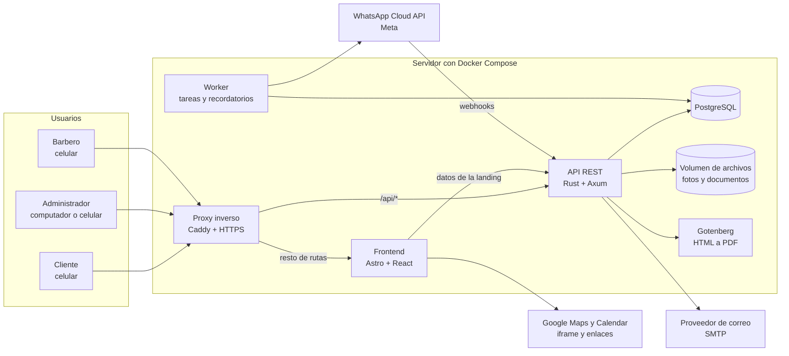
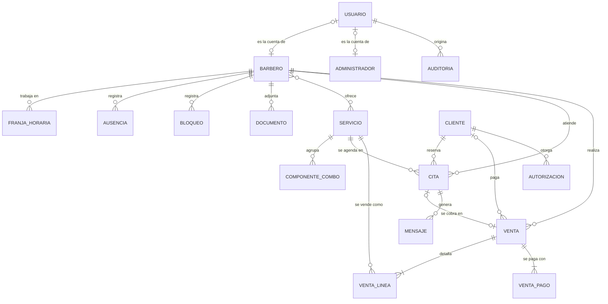

# Documento de Visión

## Plataforma web de reservas y administración para barbería

| Campo | Valor |
|---|---|
| Proyecto | Diamante Barbería — plataforma de reservas y administración |
| Documento | Documento de Visión |
| Versión | 1.1 — decisiones incorporadas |
| Fecha | 18 de noviembre de 2026 |
| Elaborado por | [Nombre del autor] |
| Aprobado por | [Propietario(a) de la barbería] |
| Fuente principal | Mockup navegable `plataforma-barberia(1).html` |

### Historial de revisiones

| Versión | Fecha | Autor | Cambios |
|---|---|---|---|
| 1.0 | 18/11/2026 | [Autor] | Versión inicial, elaborada a partir del análisis detallado del mockup. |
| 1.1 | 18/11/2026 | [Autor] | Se incorporan las decisiones DA-01 a DA-17 (sección 9), el frontend con Astro + React y el despliegue con Docker Compose. |

### Contenido

- [Resumen ejecutivo](#resumen-ejecutivo)
- [1. Introducción](#1-introducción)
- [2. Posicionamiento](#2-posicionamiento)
- [3. Descripción de los usuarios y partes interesadas](#3-descripción-de-los-usuarios-y-partes-interesadas)
- [4. Visión general del producto](#4-visión-general-del-producto)
- [5. Requisitos](#5-requisitos)
- [6. Restricciones](#6-restricciones)
- [7. Requisitos de documentación](#7-requisitos-de-documentación)
- [8. Riesgos](#8-riesgos)
- [9. Decisiones del proyecto](#9-decisiones-del-proyecto)
- [Anexo A. Mapa de pantallas del mockup](#anexo-a-mapa-de-pantallas-del-mockup)
- [Anexo B. Modelo conceptual de datos](#anexo-b-modelo-conceptual-de-datos)

Documentos de diseño: [base de datos](diseno/base-de-datos.md), [API](diseno/api.md), [pruebas E2E](diseno/pruebas-e2e.md) y [plan de desarrollo](plan-de-desarrollo.md).

---

## Resumen ejecutivo

Diamante Barbería necesita dejar de agendar por chat y de llevar a mano las ventas, la caja y las comisiones. Este proyecto construye una plataforma web propia con tres frentes:

1. **Sitio público** con la carta de servicios, el equipo y un agendamiento en línea de tres pasos, con verificación del celular, confirmación y recordatorios por WhatsApp.
2. **Panel de administración** para la agenda, los barberos, los servicios, los clientes, las ventas y la caja, los reportes en PDF y la configuración del negocio.
3. **Panel del barbero** para ver sus citas, registrar sus ventas y consultar lo que gana.

Hay tres perfiles: cliente, barbero y administrador. Se construirá en un monorepo con **Astro + React** (frontend), **Rust + Axum** (API) y **PostgreSQL** (base de datos), y se desplegará con **Docker Compose**. La primera entrega (MVP) corresponde a los requisitos **Must** de la sección 5.

---

## 1. Introducción

### 1.1 Propósito

Este documento define la visión de la plataforma: qué problema resuelve, para quién, qué hará y qué no, qué capacidades tendrá y qué requisitos debe cumplir, priorizados con el método MoSCoW.

Es el acuerdo de alto nivel entre la barbería (patrocinador y usuario) y el equipo de desarrollo, y sirve de base para:

- especificar en detalle los casos de uso y sus criterios de aceptación;
- diseñar la arquitectura (Astro, Rust/Axum, PostgreSQL) y el modelo de datos;
- estimar, planear las entregas y controlar los cambios de alcance.

Se elaboró revisando el mockup navegable pantalla por pantalla, incluidos sus datos de demostración y las reglas que ya implementa (disponibilidad, estados, cálculos de venta y liquidación). Lo que no aparece en el mockup pero se necesita para operar, cumplir la ley o proteger la información se marca como **Propuesto** y debe validarse con la barbería.

### 1.2 Alcance

**Nombre del producto.** Diamante Barbería (DA-01). El mockup usa la marca provisional *AURUM Barber Club*, que se reemplaza. En este documento, «la barbería» es el negocio y «la plataforma» es el sistema.

**La plataforma hará:**

1. **Sitio público**: landing con servicios y precios, la experiencia de la casa, el equipo, trabajos recientes, reseñas, ubicación, horarios, contacto por WhatsApp y páginas legales.
2. **Agendamiento en línea** 24/7: servicio o combo → barbero (o «cualquier barbero») → día y hora con disponibilidad real → datos del cliente → verificación del celular por WhatsApp → confirmación. Cancelación y reprogramación desde un enlace.
3. **Notificaciones**: código de verificación, confirmación, recordatorios y avisos por WhatsApp; invitaciones y recuperación de contraseña por correo.
4. **Panel de administración**: dashboard, agenda de citas, barberos (datos, estados, horarios, servicios y documentos), servicios, clientes, ventas y caja, reportes en PDF y configuración.
5. **Panel del barbero**: sus citas, registro de sus ventas, lo que lleva ganado, su reporte y liquidación, su perfil, horario y bloqueos.
6. **Procesos automáticos**: cálculo de disponibilidad, asignación de barbero, recordatorios, tareas programadas, auditoría y respaldos.

**La plataforma no hará en esta versión** (detalle en la sección 5.4): pagos en línea, facturación electrónica DIAN, inventario y venta de productos, nómina o contabilidad, varias sedes, apps nativas, cuentas de cliente con contraseña, perfiles internos distintos de administrador y barbero, importación de datos previos, programas de fidelización ni campañas masivas de marketing.

**Límites con otros procesos:**

- **Registra** los pagos que se hacen en el local, pero **no los procesa** (no hay pasarela de pagos ni integración con datáfono).
- **Calcula** la liquidación de cada barbero, pero **el pago** se hace por fuera.
- **Guarda** los datos de vinculación y seguridad social del barbero como soporte, pero **no liquida** nómina ni aportes.
- **Emite** tickets internos de venta, que **no son** factura electrónica.

### 1.3 Definiciones, acrónimos y abreviaturas

#### Términos del negocio

| Término | Definición |
|---|---|
| Cita | Reserva de un cliente con un barbero para uno o más servicios, en una fecha y hora. |
| Agendamiento / reserva | Proceso de crear una cita, en línea o por el personal. |
| Estado de la cita | Sin confirmar, Confirmada, En curso, Atendida, No asistió o Cancelada (ver 4.2.4). |
| Servicio | Trabajo ofrecido con precio y duración fijos (corte, barba, combo, afeitado, cejas…). Se agrupa en categorías: Cabello, Barba, Combos, Complementos. |
| Combo | Servicio compuesto por dos o más servicios simples, con precio y duración propios (normalmente, el precio es menor que la suma de sus partes). Se agenda y se vende como un solo servicio. |
| Franja horaria | Intervalo continuo en el que un barbero atiende (p. ej., 9:00 a. m. – 1:00 p. m.). Máximo tres por día. |
| Hora de inicio (*slot*) | Hora en la que puede empezar una cita. Se ofrecen cada 30 minutos (configurable). |
| Anticipación mínima | Tiempo mínimo entre el momento de reservar y el inicio de la cita (por defecto, 2 horas). |
| Ventana de reserva | Días hacia adelante en los que se puede agendar (por defecto, 30). |
| Bloqueo puntual | Horas que un barbero retira de su agenda (diligencia, cita médica, capacitación). |
| Ausencia | Periodo sin citas por vacaciones, incapacidad o licencia. |
| Suspensión | Medida temporal de la administración: sin citas ni acceso al panel. |
| Inactivo (retirado) | Barbero que ya no trabaja en la barbería. Su historial se conserva. |
| Día especial | Festivo (cada barbero trabaja con su horario de domingo), cierre de todo el día o cierre temprano. |
| Horario de atención | No se configura: para cada día de la semana va desde la franja más temprana hasta la más tardía de los barberos activos. |
| Ocupación | Porcentaje del tiempo disponible de un barbero que está ocupado con citas. |
| Inasistencia (*no-show*) | El cliente no llega a su cita. |
| Cancelación tardía | Cancelación o reprogramación hecha con menos anticipación que el aviso mínimo (por defecto, 3 horas). Libera el horario y se registra como cancelación, no como inasistencia; queda marcada para estadísticas. |
| Cliente registrado / nuevo / ocasional | Registrado: ya existe en la base. Nuevo: se crea al agendar o al vender. Ocasional: venta sin datos del cliente, que no suma a ningún historial. |
| Segmento | Clasificación del cliente: Nuevo, Recurrente, Frecuente o Sin volver +60 días. |
| Retorno | Porcentaje de clientes que vuelven en menos de 60 días. |
| Ticket | Comprobante interno de una venta, con número consecutivo. No es factura. |
| Ticket promedio | Ventas netas divididas entre clientes atendidos. |
| Venta bruta (subtotal) | Suma de los precios de los servicios de una venta. |
| Venta neta | Venta bruta menos descuentos. Es la base de los ingresos y de las comisiones. |
| Propina | Valor voluntario y de monto libre que deja el cliente. Es 100 % del barbero, sin importar el método con que se pague, y no cuenta como venta de la barbería. |
| Comisión | Porcentaje de la venta neta que le corresponde al barbero. Es el único esquema de pago; el porcentaje es configurable (por defecto, 50 %). |
| Liquidación | Lo que se le paga al barbero en un periodo: comisión + propinas. |
| Periodo de liquidación | Semanal, quincenal o mensual. |
| Caja del día / cierre de caja | Totales del día por método de pago; el cierre compara el efectivo contado con el esperado. |
| Método de pago | Efectivo, Nequi, Daviplata, tarjeta, transferencia o link de pago. |
| Nequi / Daviplata | Billeteras digitales colombianas (de Bancolombia y Davivienda). |
| Vinculación | Forma de contratación, solo informativa: prestación de servicios o contrato laboral (indefinido o a término fijo). No cambia la forma de pago, que siempre es por comisión. |
| PILA | Planilla Integrada de Liquidación de Aportes a la seguridad social. |
| EPS / ARL | Entidad Promotora de Salud / Administradora de Riesgos Laborales. |
| CC / CE / PPT / PA | Cédula de ciudadanía / Cédula de extranjería / Permiso por Protección Temporal / Pasaporte. |
| NIT | Número de Identificación Tributaria. |
| Landing | Página principal pública de la barbería. |
| Panel | Área privada del personal (administrador o barbero). |
| Dashboard | Tablero de indicadores del administrador. |
| Habeas data | Derecho de las personas a conocer, actualizar, rectificar y suprimir sus datos personales. |

#### Acrónimos y términos técnicos

| Término | Significado |
|---|---|
| API / REST / JSON | Interfaz de programación del backend, expuesta como servicios REST que intercambian JSON. |
| Astro / isla | Framework web del frontend. Una *isla* es un componente interactivo dentro de una página que, por lo demás, es estática. |
| React | Librería de interfaz con la que se construyen las islas y los paneles. |
| SSR / prerenderizado | Renderizado de la página en el servidor en cada solicitud / generación de páginas estáticas al compilar. |
| Docker Compose | Herramienta para definir y ejecutar los contenedores del sistema (proxy, frontend, API, base de datos…). |
| Axum | Framework web en Rust para construir la API. |
| PostgreSQL | Sistema de base de datos relacional. |
| OTP | Código de un solo uso (*one-time password*) para verificar el celular. |
| Plantilla de WhatsApp | Mensaje pre-aprobado por Meta que una empresa puede enviar a sus clientes. |
| Webhook | Notificación HTTP que un servicio externo envía a la API cuando ocurre un evento. |
| RBAC | Control de acceso basado en roles. |
| HTTPS / TLS / HSTS | Comunicación cifrada y política que obliga al navegador a usarla. |
| CSRF / CSP | Falsificación de peticiones entre sitios / Política de seguridad de contenido. |
| Argon2id | Algoritmo recomendado para guardar contraseñas de forma segura. |
| PITR / RPO / RTO | Recuperación a un punto en el tiempo / Pérdida máxima de datos tolerable / Tiempo máximo de recuperación. |
| LCP / INP / CLS | Métricas de experiencia de carga, respuesta y estabilidad visual (Core Web Vitals). |
| WCAG / ARIA | Pautas de accesibilidad web / Atributos de accesibilidad en HTML. |
| OWASP ASVS | Estándar de verificación de seguridad de aplicaciones. |
| SEO | Optimización para buscadores. |
| CDN | Red de distribución de contenido. |
| ICS | Formato estándar de archivos de calendario. |
| KPI | Indicador clave de desempeño. |
| MVP | Producto mínimo viable: primera versión que se puede usar en producción. |
| MoSCoW | Método de priorización: Must, Should, Could, Won't. |
| CU / RF / RNF / RN | Caso de uso / Requisito funcional / Requisito no funcional / Regla de negocio. |
| COP | Peso colombiano. |
| SIC / DIAN | Superintendencia de Industria y Comercio (autoridad de protección de datos) / Dirección de Impuestos y Aduanas Nacionales. |

### 1.4 Referencias

- Mockup navegable `plataforma-barberia(1).html` (raíz del repositorio).
- Ley Estatutaria 1581 de 2012 (protección de datos personales) y Decreto 1377 de 2013, compilado en el Decreto 1074 de 2015.
- Ley 51 de 1983 (traslado de festivos en Colombia).
- WCAG 2.2: <https://www.w3.org/TR/WCAG22/>
- OWASP ASVS: <https://owasp.org/www-project-application-security-verification-standard/>
- WhatsApp Business Platform (Cloud API): <https://developers.facebook.com/docs/whatsapp/cloud-api>
- Documentación de Astro: <https://docs.astro.build>
- Documentación de Axum: <https://docs.rs/axum>
- Documentación de React: <https://react.dev>
- Documentación de Docker Compose: <https://docs.docker.com/compose/>
- Documentación de PostgreSQL: <https://www.postgresql.org/docs/>

### 1.5 Organización del documento

Las secciones 2 y 3 explican el problema, el producto y sus usuarios. La sección 4 describe la arquitectura general, todos los casos de uso por rol, las reglas de negocio y los supuestos. La sección 5 lista los requisitos funcionales y no funcionales priorizados. Las secciones 6 a 9 recogen restricciones, documentación, riesgos y decisiones pendientes. Los anexos relacionan las pantallas del mockup y el modelo conceptual de datos. El diseño detallado está en `docs/diseno/` (base de datos, API y pruebas E2E) y en `docs/plan-de-desarrollo.md`.

---

## 2. Posicionamiento

### 2.1 Oportunidad de negocio y declaración del problema

Una barbería de autor que trabaja con cita previa depende de que alguien responda mensajes y llamadas para llenar la agenda. Cuando el negocio está cerrado o el equipo está ocupado atendiendo, las reservas se pierden. Las inasistencias dejan sillas vacías que nadie alcanza a ocupar, y la información del negocio (ventas por método de pago, comisiones, propinas, clientes que dejaron de venir) queda repartida entre chats, cuadernos y hojas de cálculo.

La oportunidad es convertir esa operación en un sistema propio que:

- **capte reservas las 24 horas** con disponibilidad real, sin intervención del personal;
- **reduzca las inasistencias** con verificación del celular, recordatorios y una política clara;
- **ordene el día** con una agenda única por barbero y el registro de cada venta en el momento;
- **dé transparencia** a las liquidaciones de comisiones y propinas, para el administrador y para cada barbero;
- **retenga clientes**, identificando a quienes llevan más de 60 días sin volver, los cumpleaños y los más frecuentes;
- **refuerce la marca** con una experiencia digital premium, coherente con la del local.

| Declaración del problema | |
|---|---|
| **El problema de** | agendar por mensajes y llamadas, y llevar a mano la agenda, las ventas, la caja y las comisiones |
| **afecta a** | los clientes, que dependen del horario y de la respuesta de la barbería para reservar; al administrador, que pierde tiempo coordinando y cuadrando; a los barberos, que no ven su agenda ni lo que ganan; y al propietario, que no tiene datos confiables |
| **cuyo impacto es** | sillas vacías por inasistencias y huecos sin aprovechar, cruces de horario, reservas perdidas fuera del horario de atención, errores y discusiones en las liquidaciones, descuadres de caja, clientes que dejan de venir sin que nadie lo note y decisiones sin información |
| **una solución exitosa sería** | una plataforma propia en la que el cliente agenda solo, en menos de un minuto y con disponibilidad real; que confirma y recuerda las citas por WhatsApp; y que centraliza agenda, ventas, caja, liquidaciones, clientes y equipo, con reportes listos para descargar |

> La situación actual descrita se infiere del mockup. Debe validarse con la barbería (S-09).

### 2.2 Declaración de posición del producto

| Declaración de posición | |
|---|---|
| **Para** | barberías de autor que trabajan con cita previa (inicialmente, Diamante Barbería) y sus clientes |
| **que** | necesitan llenar la agenda, reducir inasistencias y controlar ventas, caja y comisiones sin depender de chats ni de hojas de cálculo |
| **la plataforma** | es una aplicación web de reservas en línea y administración del negocio |
| **que** | permite agendar 24/7 en tres pasos, con verificación y recordatorios por WhatsApp, y da al administrador y a cada barbero las herramientas para operar el día y liquidar el periodo desde el celular o el computador |
| **a diferencia de** | la gestión manual y de las plataformas genéricas de agendamiento para salones y barberías |
| **nuestro producto** | es propio y lleva la marca de la barbería (sin marketplace que muestre a la competencia, sin cuotas por profesional ni cobros por reserva), está adaptado a la operación colombiana (Nequi y Daviplata, festivos, tipos de documento, vinculaciones y seguridad social, Ley 1581) e integra la liquidación de comisiones y propinas con la agenda y la caja |

**Alternativas y competencia**

| Alternativa | Ventajas | Desventajas |
|---|---|---|
| Gestión manual (WhatsApp, llamadas, cuaderno, hojas de cálculo) | Sin costo de software; todos la conocen | Depende de que alguien responda; dobles reservas; sin recordatorios automáticos; liquidaciones y cuadres manuales propensos a error; sin datos para decidir |
| Plataformas SaaS para barberías y salones (p. ej., Booksy, Fresha, AgendaPro) | Listas para usar; apps móviles; un marketplace que puede atraer clientes nuevos | Pago recurrente por profesional o comisiones por transacción; la marca convive con la de la plataforma y su marketplace muestra otras barberías; reglas, liquidación y reportes limitados a lo que ofrece el proveedor; los datos de los clientes quedan en manos de un tercero |
| Agendas genéricas (p. ej., Calendly, Google Calendar) | Bajo costo; fáciles de usar | No manejan servicios con duración, varios barberos, ventas, caja ni comisiones |
| **Plataforma propia (este proyecto)** | Marca propia y experiencia premium; reglas a la medida; liquidación integrada; control total de los datos; sin costo por profesional | Inversión inicial de desarrollo; la barbería asume el hosting, la mensajería y el mantenimiento |

---

## 3. Descripción de los usuarios y partes interesadas

### 3.1 Resumen de partes interesadas

| Parte interesada | Descripción | Responsabilidades en el proyecto |
|---|---|---|
| Propietario(a) de la barbería | Patrocinador. Puede ser también el administrador. | Aprobar alcance y prioridades; definir reglas (comisiones, políticas, horarios); entregar contenido y textos legales; aceptar las entregas. |
| Administrador(a) | Opera el negocio a diario (en el mockup, «Laura Martínez»). | Validar los flujos de agenda, ventas, caja y reportes; participar en las pruebas; capacitar al equipo. |
| Barberos | Prestan los servicios (seis en el mockup). | Validar «Mis citas», el registro de ventas y la liquidación; mantener su horario al día. |
| Clientes | Personas que reservan y reciben los servicios. | Participan, de forma representada, en pruebas de usabilidad del agendamiento. |
| Equipo de desarrollo | Diseño (mockup), construcción, despliegue y soporte. | Frontend (Astro), backend (Rust/Axum), base de datos (PostgreSQL), integraciones, calidad y documentación. |
| Contador(a) o asesor(a) contable | Usa los reportes de ventas y liquidaciones. | Validar cálculos, formatos de exportación y obligaciones tributarias. |
| Proveedores externos | Meta (WhatsApp), proveedor de correo, hosting. | Servicios de los que depende la operación. |
| Autoridades | SIC (protección de datos) y DIAN (tributaria). | Marco de cumplimiento. La barbería no está obligada a facturar electrónicamente (DA-11). |

### 3.2 Perfiles de usuario

| Perfil | Quién es | Nivel técnico | Frecuencia de uso | Dispositivo y contexto | Qué hace en el sistema |
|---|---|---|---|---|---|
| **Visitante / Cliente** | Persona que busca un corte, arreglo de barba u otro servicio; puede ser nueva o habitual. No tiene contraseña: se identifica con su celular y un código que recibe por WhatsApp. | Básico: usa WhatsApp y navega en el celular. | Ocasional: cada 2 a 6 semanas. Pasados 60 días sin volver se considera inactivo. | Celular, en cualquier lugar y a cualquier hora, con datos móviles. Sesiones cortas. | Consulta servicios y equipo, agenda, verifica su celular, recibe confirmación y recordatorios, cancela o reprograma. |
| **Administrador(a)** | Responsable de la operación; puede ser el propietario. | Medio: ofimática y aplicaciones web. | Diaria, durante toda la jornada. | Computador en el mostrador y celular. | Todo: agenda, equipo, servicios, clientes, ventas, caja, reportes y configuración. |
| **Barbero** | Profesional que presta los servicios. | Básico: usa el celular para WhatsApp y redes sociales. | Diaria, en momentos cortos entre un servicio y otro. | Su celular personal, de pie y con las manos ocupadas. | Revisa sus citas, registra sus ventas, marca inasistencias, consulta lo que lleva y su liquidación, ajusta su horario y sus bloqueos. |
| **Propietario(a)** (si no es el administrador) | Dueño del negocio. | Medio. | Semanal o mensual. | Celular o computador. | Consulta el dashboard y los reportes. |
| **Contador(a)** (usuario indirecto) | Asesor externo. | Medio a alto. | Quincenal o mensual. | Recibe archivos PDF o Excel. | No entra al sistema; usa los reportes. |

El sistema tiene solo tres perfiles: **Cliente**, **Barbero** y **Administrador** (DA-06). El propietario usa el perfil de administrador, y el contador no es un perfil del sistema.

### 3.3 Necesidades de los usuarios y partes interesadas

| ID | Necesidad | Interesados | Prioridad | Situación actual (a validar) | Solución propuesta |
|---|---|---|---|---|---|
| N-01 | Agendar a cualquier hora sin escribir ni llamar | Cliente | Alta | Mensajes o llamadas en horario de atención | Agendamiento en línea 24/7 con disponibilidad real |
| N-02 | Conocer precio y duración antes de ir | Cliente | Alta | Preguntar por chat | Carta de servicios con precio y duración fijos |
| N-03 | No olvidar la cita y poder cancelarla fácilmente | Cliente | Alta | Sin recordatorios | Confirmación y recordatorios por WhatsApp con enlace de gestión |
| N-04 | Elegir a su barbero de confianza | Cliente | Media | Preguntar disponibilidad | Selección de barbero con su próxima hora libre |
| N-05 | Ver la agenda de todos en un solo lugar, sin cruces | Administrador | Alta | Cuaderno y chats | Agenda por barbero; la base de datos impide solapes |
| N-06 | Reducir las inasistencias | Propietario | Alta | Sin control | Verificación por código, recordatorios y política de inasistencias |
| N-07 | Registrar ventas rápido y por método de pago | Administrador, Barberos | Alta | Cuaderno u hoja de cálculo | Registro de venta desde la cita, caja del día y cierre |
| N-08 | Liquidar comisiones y propinas sin errores ni discusiones | Propietario, Barberos | Alta | Cálculo manual | Liquidación automática y reporte por barbero en PDF |
| N-09 | Que cada barbero vea su agenda y lo que gana desde el celular | Barberos | Alta | Preguntar en recepción | Panel del barbero |
| N-10 | Conocer el desempeño del negocio | Propietario | Media | Intuición | Dashboard y reportes |
| N-11 | Recuperar y fidelizar clientes | Propietario | Media | Sin seguimiento | Segmentos, alerta de +60 días, cumpleaños y lista para reactivar |
| N-12 | Gestionar el equipo: datos, documentos, ausencias y horarios | Administrador | Media | Carpetas y hojas de cálculo | Módulo de barberos con estados, horarios y documentos |
| N-13 | Imagen profesional y premium de la marca | Propietario | Media | Redes sociales | Landing con identidad visual propia |
| N-14 | Cumplir la ley de protección de datos | Propietario | Alta | Sin formalizar | Autorizaciones con trazabilidad, políticas publicadas y control de acceso |
| N-15 | Costos recurrentes bajos y control de la plataforma | Propietario | Media | — | Plataforma propia: solo se paga hosting y mensajería |

### 3.4 Entorno del usuario

**Entorno físico**

- **Clientes**: reservan desde el celular, en cualquier lugar, muchas veces fuera del horario de atención y en sesiones cortas. El flujo debe ser breve y tolerar interrupciones.
- **Mostrador** (administración): computador o tableta con conexión estable. Es un ambiente ruidoso, en el que se atiende a la vez a clientes presenciales y al teléfono, así que las acciones frecuentes deben estar a uno o dos clics.
- **Barberos**: trabajan de pie, con las manos ocupadas o con producto, y miran el celular entre servicios. Necesitan botones grandes, la información clave a primera vista y pocos toques por tarea. Usan su celular personal, así que cada uno debe tener su propia sesión.

**Entorno tecnológico**

- Navegadores actualizados en Android e iOS de gama media y en computadores de escritorio. Pantallas desde 320 px de ancho. No hay que instalar nada.
- Se necesita conexión a internet. No hay modo sin conexión: si se cae el internet del local, se trabaja con un respaldo manual y se registra después.
- No se necesita hardware especial. La impresora es opcional, porque los reportes se descargan en PDF. El datáfono no se integra: el pago con tarjeta se registra a mano como método de pago.
- WhatsApp es el canal de comunicación principal con los clientes.
- Idioma español (Colombia), pesos colombianos y zona horaria America/Bogota.

**Tiempos y volumen** (según los datos de demostración del mockup; validar con la barbería)

- Horario de atención: se calcula a partir de los horarios de los barberos (DA-10). Con los horarios del mockup resulta: lunes a viernes de 9:00 a. m. a 8:00 p. m.; sábados de 8:00 a. m. a 8:00 p. m.; domingos y festivos de 10:00 a. m. a 3:00 p. m.
- Horas pico: viernes y sábados entre las 4:00 y las 7:00 p. m.
- Alrededor de 6 barberos, 1.300 clientes registrados, 25 a 40 citas diarias y 700 atenciones al mes.
- Usuarios simultáneos: 1 o 2 administradores, hasta 6 barberos y decenas de clientes consultando disponibilidad.

---

## 4. Visión general del producto

### 4.1 Perspectiva del producto

La plataforma es un **producto nuevo e independiente**. Reemplaza procesos manuales y será la única fuente de verdad para la agenda, los clientes, las ventas y el equipo. No reemplaza ni se integra con un sistema existente de la barbería, y arranca sin datos previos (DA-16). Se apoya en servicios externos para la mensajería, el correo y los mapas.

**Diagrama de contexto**

**Componentes**

| Componente | Tecnología | Responsabilidad |
|---|---|---|
| Proxy inverso | Caddy | HTTPS automático; enruta `/api/*` a la API y el resto al frontend, bajo el mismo dominio. |
| Sitio público | Astro con renderizado en servidor (Node) | Landing renderizada en el servidor con caché corta (RF-PUB-04); páginas legales prerenderizadas. |
| Agendamiento y gestión de cita | Astro + isla de React | Consulta la disponibilidad en vivo, verifica el código, crea, cancela y reprograma citas. |
| Paneles (administrador y barbero) | Astro + React (aplicación de una sola página montada en una ruta comodín) | Aplicación interactiva autenticada y no indexable. |
| API | Rust + Axum (REST/JSON) | Reglas de negocio, autenticación y permisos, disponibilidad, ventas, liquidación, reportes PDF y Excel, integraciones. |
| Worker | Rust (mismo código que la API, en otro proceso) + cola de trabajos en PostgreSQL | Recordatorios, reintentos de mensajes y tareas programadas. |
| Base de datos | PostgreSQL 18 | Datos del negocio (un esquema por módulo), auditoría y cola de trabajos. |
| Archivos | Volumen de Docker | Fotos de barberos (públicas) y documentos (privados, servidos con URL firmadas). |
| Generador de PDF | Gotenberg | Convierte a PDF los reportes renderizados en HTML. |
| Respaldos | Contenedor con `pg_dump` programado | Copias diarias de la base de datos y de los archivos. |

**Sobre el uso de Astro.** Es cierto que gran parte de la landing cambia poco, pero el contenido es de tres tipos y cada uno se trata distinto:

1. **Estático de verdad** (textos de «La experiencia», políticas, galería y reseñas): se prerenderiza.
2. **Cambia por acciones del administrador** (servicios, precios, barberos, horarios, datos del negocio): la landing se renderiza en el servidor y se guarda en caché unos minutos (RF-PUB-04). Así refleja los cambios sin regenerar el sitio, algo que con Docker Compose exigiría un proceso de compilación aparte.
3. **Cambia con el tiempo o en tiempo real** (disponibilidad, «de vacaciones hasta…», agenda, ventas): se consulta en vivo a la API desde islas de React.

El sitio y la API se sirven bajo el mismo dominio (`/api` detrás de Caddy), lo que simplifica las cookies de sesión y evita configurar CORS.

**Interfaces externas**

| Sistema externo | Uso | Tipo de integración |
|---|---|---|
| WhatsApp Cloud API (Meta, API oficial; DA-14) | Códigos de verificación, confirmaciones, recordatorios y avisos; respuestas de confirmación | API para enviar plantillas + webhooks de estados y respuestas |
| Proveedor de correo | Invitaciones y recuperación de contraseña | SMTP |
| Google Maps | Mapa de ubicación y «Cómo llegar» | Iframe embebido y enlaces |
| Google Calendar | «Agregar a mi calendario» | Enlace con plantilla de evento (sin API) |
| Enlaces de WhatsApp e Instagram | Contacto directo y perfiles | Enlaces `wa.me` e Instagram |

### 4.2 Capacidades

#### 4.2.1 Resumen de capacidades

| Beneficio | Capacidades que lo hacen posible |
|---|---|
| Los clientes agendan solos, 24/7, en menos de un minuto | Agendamiento en tres pasos, disponibilidad real, reconocimiento del cliente habitual, verificación por WhatsApp |
| Menos inasistencias y menos huecos en la agenda | Verificación del celular, recordatorios con confirmación, cancelación fácil por enlace, política de inasistencias |
| Cero cruces de horario | Cálculo de disponibilidad, bloqueo de solapes en la base de datos, ausencias y bloqueos puntuales |
| Operación diaria ágil desde el mostrador o el celular | Agenda por barbero, venta registrada desde la cita, caja del día y cierre |
| Liquidaciones transparentes | Comisión y propinas calculadas automáticamente, reportes en PDF, panel del barbero |
| Decisiones con datos | Dashboard, reportes, horas pico, ventas por servicio, ocupación |
| Clientes que vuelven | Segmentos, alerta de +60 días, cumpleaños, lista para reactivar |
| Equipo y marca bajo control | Gestión de barberos, estados, horarios y servicios; landing que se actualiza sola |
| Cumplimiento legal | Autorizaciones con prueba, políticas publicadas, permisos por rol, auditoría |

#### 4.2.2 Matriz de roles y permisos

| Función | Cliente (sin contraseña) | Barbero | Administrador |
|---|---|---|---|
| Sitio público y agendamiento en línea | Sí | Sí | Sí |
| Gestionar su cita por enlace | Solo la suya | — | — |
| Dashboard | No | No | Sí |
| Agenda | No | Solo sus citas | Todos los barberos |
| Crear, reprogramar y cancelar citas | Solo las suyas, por enlace | No | Sí |
| Iniciar la atención, marcar inasistencia y enviar recordatorios | No | Solo sus citas | Sí |
| Registrar ventas | No | Solo propias; solo descuentos habilitados para barberos | Sí |
| Anular ventas | No | No | Sí |
| Caja del día y cierre de caja | No | Solo «lo que llevas hoy» | Sí |
| Clientes | No | Datos de sus clientes en sus citas | Sí |
| Exportar datos (clientes, barberos) | No | No | Sí |
| Barberos | No | Su perfil en lectura; edita sus servicios, horario y bloqueos | Sí |
| Servicios | Consulta pública | Consulta | Sí |
| Reportes | No | Solo su reporte | Sí |
| Configuración y administradores | No | No | Sí |

#### 4.2.3 Casos de uso por rol

Lista completa de casos de uso del sistema. La columna «Pantalla» indica dónde aparece en el mockup; «Propuesto» significa que no está en el mockup.

##### A. Visitante y cliente

| ID | Caso de uso | Actor(es) | Descripción y reglas clave | Pantalla |
|---|---|---|---|---|
| CU-01 | Consultar el sitio público | Visitante | Ver portada, carta de servicios (precio y duración), «La experiencia», equipo (los barberos de vacaciones aparecen con su fecha de regreso), trabajos recientes, reseñas, ubicación, horario y contacto. | `#/` |
| CU-02 | Contactar por WhatsApp | Visitante | Abrir una conversación con la barbería desde el botón flotante, la sección de ubicación o el pie de página. | `#/` |
| CU-03 | Ver cómo llegar | Visitante | Ver el mapa embebido y abrir la ruta en Google Maps. | `#/` |
| CU-04 | Consultar las políticas | Visitante | Leer la política de tratamiento de datos, la de cancelación y los términos del servicio. | Enlaces del pie (páginas sin diseñar) |
| CU-05 | Agendar una cita en línea | Cliente | Servicio o combo → barbero o «Cualquier barbero» → día y hora → datos → verificación del celular → confirmación. Se puede empezar con un servicio o un barbero preseleccionado desde la landing. | `#/agendar` |
| CU-06 | Verificar el celular | Cliente | Escribir el código de 4 dígitos recibido por WhatsApp; se puede pedir que lo reenvíen. Sin verificación no se crea la cita. | `#/agendar` (modal) |
| CU-07 | Ser reconocido como cliente habitual | Cliente | Si el celular ya existe, el sistema completa nombre y correo y saluda al cliente (después de verificar el código; ver RF-RES-08). | `#/agendar` |
| CU-08 | Recibir la confirmación | Cliente | Ver el resumen (barbero, servicio, fecha y hora, dirección, total a pagar en el local), agregar la cita a Google Calendar, ver cómo llegar y recibir la confirmación por WhatsApp con el enlace de gestión. | `#/agendar/confirmada` |
| CU-09 | Recibir recordatorios y confirmar asistencia | Cliente | Recibir recordatorios (24 h y 2 h antes, según la configuración) y confirmar o cancelar con un toque. | WhatsApp |
| CU-10 | Cancelar la cita | Cliente | Desde el enlace único, cancelar en cualquier momento antes de la hora de inicio. Si faltan menos horas que el aviso mínimo (por defecto, 3 h), queda marcada como cancelación tardía; nunca cuenta como inasistencia. | Enlace en `#/agendar/confirmada` (pantalla sin diseñar) |
| CU-11 | Reprogramar la cita | Cliente | Desde el mismo enlace, y hasta la hora de inicio, elegir otra fecha u hora con las mismas reglas de disponibilidad. | Ídem |
| CU-12 | Autorizar el tratamiento de datos | Cliente | Aceptar la política de tratamiento de datos (obligatorio), que incluye recibir por WhatsApp la confirmación y los recordatorios de la cita. Los recordatorios se pueden desactivar desde el enlace de la cita. | `#/agendar` |
| CU-13 | Ejercer derechos sobre sus datos | Cliente | Pedir consulta, actualización o supresión de sus datos por el canal publicado en la política. El administrador la atiende (CU-50). | Propuesto |

##### B. Personal (administradores y barberos)

| ID | Caso de uso | Actor(es) | Descripción y reglas clave | Pantalla |
|---|---|---|---|---|
| CU-14 | Iniciar sesión | Administrador, Barbero | Correo y contraseña, con opción «Recordarme». El sistema lleva a cada usuario al panel de su rol. | `#/acceso` |
| CU-15 | Activar la cuenta | Personal | Abrir la invitación recibida por correo y crear la contraseña. | Sin diseñar |
| CU-16 | Recuperar la contraseña | Personal | Pedir un enlace por correo y definir una contraseña nueva. | `#/acceso` (enlace) |
| CU-17 | Cerrar sesión o ir a la página pública | Personal | Salir del panel o abrir el sitio público desde el menú. | Menú lateral |

##### C. Administrador

**C.1 Dashboard**

| ID | Caso de uso | Actor(es) | Descripción y reglas clave | Pantalla |
|---|---|---|---|---|
| CU-18 | Consultar los indicadores del día | Administrador | Ventas netas hasta la hora actual, clientes atendidos, servicios realizados, ticket promedio y propinas, comparados con el mismo día de la semana anterior; tendencia de los últimos 12 días. | `#/admin` |
| CU-19 | Consultar el rendimiento por barbero | Administrador | Servicios, clientes, ventas, propinas y ocupación de cada barbero hoy; barberos ausentes; acceso al reporte detallado. | `#/admin` |
| CU-20 | Consultar las citas de hoy | Administrador | Distribución por estado y próximas citas, con acceso a la agenda. | `#/admin` |
| CU-21 | Consultar tendencias | Administrador | Clientes por mes frente al año anterior, ventas por servicio del mes, horas pico y clientes del mes (nuevos, recurrentes, retorno). | `#/admin` |
| CU-22 | Revisar notificaciones y alertas | Administrador | Citas de mañana sin confirmar, cumpleaños de la semana, ausencias de barberos, clientes por reactivar, cambios de horario con citas afectadas y solicitudes de corrección. | `#/admin` (modal) |

**C.2 Agenda**

| ID | Caso de uso | Actor(es) | Descripción y reglas clave | Pantalla |
|---|---|---|---|---|
| CU-23 | Consultar la agenda | Administrador | Vista de día por barbero (tablero) o de lista; navegar entre días, volver a hoy y filtrar por barbero; ver los bloques no disponibles y la hora actual. | `#/admin/agenda` |
| CU-24 | Ver el detalle de una cita | Administrador | Estado, cliente, celular, historial, servicio, barbero, horario, valor, origen y nota del cliente. En citas cerradas, el resultado (venta registrada, inasistencia o cancelación). | `#/admin/agenda` |
| CU-25 | Agendar en nombre de un cliente | Administrador | Crear una cita para un cliente que llama o llega al local, sin código de verificación. Queda con origen «Agendada por el personal». | `#/admin/agenda` → «Nueva cita» |
| CU-26 | Reprogramar una cita | Administrador | Cambiar fecha, hora o barbero; el cliente recibe el cambio por WhatsApp. | `#/admin/agenda` |
| CU-27 | Cancelar una cita | Administrador | Indicar el motivo y, si se quiere, avisar al cliente por WhatsApp; el horario queda libre. | `#/admin/agenda` (modal) |
| CU-28 | Marcar una inasistencia | Administrador | Marcar «No asistió» (solo el día de la cita o después); suma al historial del cliente. | `#/admin/agenda` |
| CU-29 | Enviar un recordatorio | Administrador | Enviar un recordatorio manual por WhatsApp. | `#/admin/agenda` |
| CU-30 | Atender una cita y registrar su venta | Administrador | Abrir el registro de venta con la cita precargada; al registrarla, la cita queda «Atendida». | `#/admin/agenda` → `#/admin/ventas` |

**C.3 Barberos**

| ID | Caso de uso | Actor(es) | Descripción y reglas clave | Pantalla |
|---|---|---|---|---|
| CU-31 | Consultar el equipo | Administrador | Listado con foto, especialidad, documento, celular, servicios, estado y fecha de ingreso; búsqueda, filtro por estado e indicadores del equipo. | `#/admin/barberos` |
| CU-32 | Exportar el listado de barberos | Administrador | Descargar el listado en Excel. | `#/admin/barberos` |
| CU-33 | Registrar un barbero | Administrador | Diligenciar foto, datos personales, contacto y emergencia, perfil para la landing, contratación y pago, seguridad social, horario, servicios, documentos, visibilidad y acceso; ver la vista previa de su tarjeta. | `#/admin/barberos/nuevo` |
| CU-34 | Editar los datos de un barbero | Administrador | Modificar cualquier dato del registro. | `#/admin/barberos/nuevo?b=…` |
| CU-35 | Cambiar el estado de un barbero | Administrador | Activo, Vacaciones, Incapacidad o licencia, Suspendido o Inactivo, con fechas, motivo y soporte según el caso. | `#/admin/barberos/editar?b=…` |
| CU-36 | Gestionar las citas afectadas por una ausencia | Administrador | Ver las citas que caen dentro del rango y reasignarlas a otro barbero o avisar a los clientes para reprogramar. | `#/admin/barberos/editar?b=…` |
| CU-37 | Definir el horario de un barbero | Administrador | Igual toda la semana o diferente por día, con hasta tres franjas por día. | Registro y edición del barbero |
| CU-38 | Definir los servicios de un barbero | Administrador | Activar o quitar los servicios que ofrece. | Registro y edición del barbero |
| CU-39 | Gestionar los documentos del barbero | Administrador | Cargar o quitar identidad, contrato, hoja de vida, certificados y afiliaciones, y el soporte mensual de la PILA. | `#/admin/barberos/nuevo` |
| CU-40 | Controlar visibilidad y acceso | Administrador | Mostrar u ocultar en la landing, habilitar citas en línea y dar acceso al panel (se envía la invitación). | `#/admin/barberos/nuevo` |
| CU-41 | Consultar el historial de cambios | Administrador | Ver quién cambió el estado, el horario o los servicios, y cuándo. | `#/admin/barberos/editar?b=…` |

**C.4 Servicios**

| ID | Caso de uso | Actor(es) | Descripción y reglas clave | Pantalla |
|---|---|---|---|---|
| CU-42 | Consultar los servicios | Administrador | Lista con duración, número de barberos, precio y estado; detalle con unidades vendidas e ingresos del mes anterior y los barberos que lo ofrecen. | `#/admin/servicios` |
| CU-43 | Crear o editar un servicio | Administrador | Nombre, descripción, precio, categoría, si se agenda en línea, duración, barberos, si está activo y si se muestra en la landing. | `#/admin/servicios` (modal) |
| CU-44 | Activar o desactivar un servicio | Administrador | Un servicio inactivo deja de venderse, de agendarse y de mostrarse. | `#/admin/servicios` |
| CU-45 | Asignar o quitar barberos de un servicio | Administrador | Desde el detalle del servicio. | `#/admin/servicios` |

**C.5 Clientes**

| ID | Caso de uso | Actor(es) | Descripción y reglas clave | Pantalla |
|---|---|---|---|---|
| CU-46 | Buscar y segmentar clientes | Administrador | Búsqueda por nombre, celular o correo; filtros Frecuentes, Nuevos y Sin volver +60 días; indicadores de la base. | `#/admin/clientes` |
| CU-47 | Consultar la ficha del cliente | Administrador | Visitas, total gastado, ticket promedio, inasistencias, cliente desde, cumpleaños, preferencias, autorizaciones y últimas visitas. | `#/admin/clientes` |
| CU-48 | Agendar o escribir desde la ficha | Administrador | Crear una cita con el cliente precargado o abrir WhatsApp. | `#/admin/clientes` |
| CU-49 | Exportar clientes | Administrador | Descargar la base en Excel (acción auditada). | `#/admin/clientes` |
| CU-50 | Actualizar o suprimir los datos de un cliente | Administrador | Corregir datos y preferencias; anonimizar a petición del titular, conservando las cifras de ventas. | Propuesto |

**C.6 Ventas y caja**

| ID | Caso de uso | Actor(es) | Descripción y reglas clave | Pantalla |
|---|---|---|---|---|
| CU-52 | Registrar una venta | Administrador | Opcionalmente desde una cita; cliente registrado, nuevo u ocasional; barbero; servicios; descuento con motivo; propina; método de pago. Ticket consecutivo. | `#/admin/ventas` |
| CU-53 | Consultar la caja del día | Administrador | Total neto, número de ventas, propinas, desglose por método de pago y últimas ventas filtrables por barbero. | `#/admin/ventas` |
| CU-54 | Hacer el cierre de caja | Administrador | Comparar lo esperado por método de pago (incluidas las propinas) con lo contado y registrar la diferencia. | `#/admin/ventas` (modal) |
| CU-55 | Anular una venta | Administrador | Anular con motivo; la anulación queda en la auditoría y la venta sale de los totales. | Propuesto (el mockup la menciona) |

**C.7 Reportes**

| ID | Caso de uso | Actor(es) | Descripción y reglas clave | Pantalla |
|---|---|---|---|---|
| CU-56 | Generar el resumen de ventas y servicios | Administrador | Por mes o por rango: indicadores, ventas por semana, por servicio, por método de pago y por barbero, con comisiones. | `#/admin/reportes` |
| CU-57 | Generar el reporte detallado por barbero | Administrador | Indicadores, servicios realizados, liquidación (comisión + propinas) y detalle de ventas; de un barbero o de todos. | `#/admin/reportes` |
| CU-58 | Generar el reporte de clientes | Administrador | Atendidos, nuevos, recurrentes, retorno, inasistencias, clientes con más visitas y lista para reactivar. | `#/admin/reportes` |
| CU-59 | Descargar reportes en PDF | Administrador; Barbero (solo el suyo) | Vista previa en pantalla y descarga en PDF. | `#/admin/reportes`, `#/barbero/reportes` |

**C.8 Configuración**

| ID | Caso de uso | Actor(es) | Descripción y reglas clave | Pantalla |
|---|---|---|---|---|
| CU-60 | Configurar los datos de la barbería | Administrador | Nombre comercial, NIT, dirección, WhatsApp, Instagram y comisión por defecto. | `#/admin/configuracion` |
| CU-61 | Configurar las reglas de agendamiento | Administrador | Anticipación mínima, ventana de reserva, intervalo de horas, aviso mínimo de cancelación, recordatorios, política de inasistencias y umbrales de segmentos. | `#/admin/configuracion` |
| CU-62 | Configurar los días especiales | Administrador | Festivos, cierres y cierres tempranos. El horario general no se configura: se calcula a partir de los horarios de los barberos (DA-10). | `#/admin/configuracion` |
| CU-63 | Gestionar los administradores | Administrador | Invitar por correo a otros administradores y desactivarlos. Las cuentas de los barberos se gestionan desde su ficha (CU-40). | `#/admin/configuracion` |
| CU-64 | Configurar los métodos de pago | Administrador | Habilitar o deshabilitar efectivo, Nequi, Daviplata, tarjeta, transferencia y link de pago. | `#/admin/configuracion` |

##### D. Barbero

| ID | Caso de uso | Actor(es) | Descripción y reglas clave | Pantalla |
|---|---|---|---|---|
| CU-65 | Consultar mis citas | Barbero | Hoy, mañana y próximos 7 días, con indicadores, días libres, festivos y días con agenda llena. | `#/barbero/citas` |
| CU-66 | Atender una cita y registrar la venta | Barbero | Desde una cita de hoy, registrar la venta a su nombre; la cita queda «Atendida». | `#/barbero/citas` → `#/barbero/ventas` |
| CU-67 | Registrar una venta sin cita | Barbero | Para un cliente sin reserva (nuevo u ocasional). | `#/barbero/ventas` |
| CU-68 | Marcar una inasistencia | Barbero | En sus citas de hoy, con confirmación. | `#/barbero/citas` |
| CU-69 | Contactar o recordar a un cliente | Barbero | Abrir WhatsApp o enviar el recordatorio de una cita futura. | `#/barbero/citas` |
| CU-70 | Consultar mis ventas del día | Barbero | Lo que lleva hoy (comisión + propinas), sus ventas netas y la lista de sus ventas. | `#/barbero/ventas` |
| CU-71 | Consultar mi reporte y liquidación | Barbero | Reporte detallado propio por mes o por rango, con descarga en PDF. | `#/barbero/reportes` |
| CU-72 | Consultar mi perfil y pedir correcciones | Barbero | Ver sus datos personales y de contratación (solo lectura) y pedir al administrador que corrija un dato. | `#/barbero/perfil` |
| CU-73 | Actualizar mis servicios | Barbero | Marcar los servicios que ofrece. | `#/barbero/perfil` |
| CU-74 | Actualizar mi horario | Barbero | Editar sus franjas; si el cambio afecta citas, verlas antes de guardar. El administrador recibe un aviso. | `#/barbero/perfil` |
| CU-75 | Bloquear horas puntuales | Barbero | Crear y eliminar bloqueos (cita médica, diligencia personal, capacitación, otro). | `#/barbero/perfil` |

##### E. Sistema (procesos automáticos)

| ID | Caso de uso | Actor(es) | Descripción y reglas clave | Pantalla |
|---|---|---|---|---|
| CU-76 | Calcular la disponibilidad | Sistema | Combina horario general, días especiales, franjas del barbero, ausencias, bloqueos, citas, duración del servicio, intervalo, anticipación mínima y ventana de reserva. | — |
| CU-77 | Asignar barbero automáticamente | Sistema | Cuando el cliente elige «Cualquier barbero». | — |
| CU-78 | Gestionar los mensajes de WhatsApp | Sistema | Enviar códigos, confirmaciones, recordatorios y avisos; reintentar los fallidos; procesar estados y respuestas. | — |
| CU-79 | Enviar correos transaccionales | Sistema | Invitaciones y recuperación de contraseña. | — |
| CU-80 | Ejecutar tareas programadas | Sistema | Programar recordatorios, aplicar la política de inasistencias, señalar citas pasadas sin cerrar y depurar códigos y sesiones vencidos. El estado del barbero y los segmentos de clientes se calculan según la fecha, así que no necesitan tareas. | — |
| CU-81 | Mantener actualizado el sitio público | Sistema | La landing se renderiza en el servidor con una caché corta, así que refleja los cambios en minutos sin regenerar el sitio. | — |
| CU-82 | Registrar la auditoría | Sistema | Guardar quién hizo qué y cuándo en las acciones sensibles. | — |
| CU-83 | Notificar al administrador | Sistema | Alertas internas: cambios de horario con citas afectadas, solicitudes de corrección, mensajes fallidos. | — |
| CU-84 | Respaldar la información | Sistema | Copias automáticas de la base de datos y de los archivos. | — |

Identificadores retirados en la versión 1.1 (no se reutilizan): CU-51, importación de clientes (DA-16).

#### 4.2.4 Reglas de negocio

Reglas que el mockup implementa o anuncia, con sus valores por defecto.

**Agendamiento y disponibilidad**

| ID | Regla |
|---|---|
| RN-01 | Las horas de inicio se ofrecen cada 30 minutos (configurable a 15). Una hora solo se ofrece si el servicio completo cabe dentro de una franja del barbero y no se cruza con citas activas, bloqueos ni ausencias. |
| RN-02 | Para el mismo día se exige una anticipación mínima de 2 horas, y se puede reservar hasta 30 días adelante. Ambos valores son configurables. |
| RN-03 | En los festivos, cada barbero trabaja con su horario de domingo. Los días marcados como cerrados no ofrecen horas, y un cierre temprano recorta las horas de ese día. |
| RN-04 | El horario de atención no se configura: para cada día de la semana va desde la franja más temprana hasta la más tardía de los barberos activos (DA-10). Cada barbero tiene hasta tres franjas por día. |
| RN-05 | Un barbero solo se puede agendar y vender para los servicios que ofrece. Un servicio que ningún barbero ofrece no aparece en el agendamiento. |
| RN-06 | Con «Cualquier barbero» se asigna el primer barbero disponible a esa hora que ofrezca el servicio, según el orden del equipo (el mismo de la landing; DA-03). El cliente ve a quién se asignó antes de confirmar. |
| RN-07 | Para reservar en línea solo se piden nombre, celular colombiano (verificado con código), correo (opcional) y fecha de nacimiento (opcional), además de la autorización de tratamiento de datos (DA-12). |
| RN-08 | El cliente se identifica por su número de celular, que es único. |
| RN-09 | El cliente puede cancelar o reprogramar desde su enlace hasta la hora de inicio. Si lo hace con menos anticipación que el aviso mínimo (3 h por defecto; configurable: 1, 3 o 24 h), queda marcado como tardío para estadísticas, pero siempre se registra como cancelación y nunca como inasistencia (DA-17). |
| RN-10 | Política de inasistencias (configurable): tras dos inasistencias, pedir confirmación por llamada (por defecto), bloquear las reservas en línea o no aplicar restricción. |
| RN-11 | «No asistió» solo puede marcarse el día de la cita o después. |

**Ventas, caja y liquidación**

| ID | Regla |
|---|---|
| RN-12 | Subtotal = suma de los precios de los servicios. Venta neta = Subtotal − Descuento. Total cobrado = Venta neta + Propina. |
| RN-13 | Los descuentos son 10 %, 15 % o $5.000 (nunca mayores que el subtotal) y exigen motivo: cliente frecuente, promoción vigente, cortesía de la casa u otro. El barbero solo puede aplicar los descuentos habilitados para barberos (por defecto, los de hasta 15 %). |
| RN-14 | La propina es de monto libre y es 100 % del barbero, sin importar el método de pago (DA-09). No es ingreso de la barbería ni base de la comisión, y se suma a la liquidación del barbero. |
| RN-15 | La comisión es el único esquema de pago (DA-05). Comisión del barbero = Venta neta × su porcentaje de comisión, que es configurable por barbero (el valor por defecto, 50 %, está en la configuración) y se guarda en cada venta. Total a pagar en la liquidación = Comisión + Propinas. |
| RN-16 | Registrar una venta desde una cita deja la cita «Atendida». Una venta con cliente registrado o nuevo suma la visita y el valor neto a su historial; una venta a «Cliente ocasional» no suma a ningún historial. |
| RN-17 | El barbero solo registra ventas a su nombre y no puede borrarlas ni anularlas. Solo el administrador anula, con motivo. |
| RN-18 | Un cambio de precio aplica a citas y ventas nuevas; lo ya registrado conserva su valor. |
| RN-19 | Cada venta tiene un número de ticket consecutivo y único. |

**Clientes e indicadores**

| ID | Regla |
|---|---|
| RN-20 | Segmentos con umbrales configurables (DA-07). Valores iniciales: Nuevo (1 o 2 visitas), Recurrente (3 a 5), Frecuente (6 o más) y Sin volver +60 días (última visita hace más de 60 días; prevalece sobre los demás). |
| RN-21 | Retorno = porcentaje de clientes que vuelven en menos de 60 días. Ticket promedio = Ventas netas ÷ clientes atendidos. Ocupación = minutos con citas ÷ minutos disponibles del barbero, descontando bloqueos. |
| RN-22 | Los reportes por mes incluyen el mes en curso hasta hoy. Un rango no puede terminar después de hoy. |

**Equipo**

| ID | Regla |
|---|---|
| RN-23 | Las vacaciones, incapacidades, suspensiones y retiros solo los registra el administrador. Los bloqueos puntuales los registra el barbero o el administrador. |
| RN-24 | El estado del barbero se calcula según la fecha, a partir de sus ausencias y su retiro: una ausencia futura no cambia el estado actual, y al terminar el rango vuelve solo a «Activo». |
| RN-25 | Retirar a un barbero bloquea su acceso y lo oculta, pero conserva su historial de citas, ventas y reportes. |
| RN-26 | Un barbero solo ve su propia información: sus citas, sus ventas, su liquidación y su perfil. |
| RN-27 | La visibilidad real de un barbero combina su estado (tabla siguiente) con los interruptores «Mostrar en la landing», «Recibe citas en línea» y «Acceso al panel». |

**Servicios, citas y perfiles**

| ID | Regla |
|---|---|
| RN-28 | Un combo es un servicio compuesto por dos o más servicios simples, con precio y duración propios. Se agenda y se vende como un solo servicio; sus componentes lo describen. |
| RN-29 | Cada cita es de un solo servicio, simple o combo (DA-02). Los servicios adicionales se agregan al registrar la venta. |
| RN-30 | Hay tres perfiles: Cliente (sin contraseña; se identifica con celular y código), Barbero y Administrador (DA-06). |
| RN-31 | Una reserva en línea verificada con código queda «Confirmada». Una cita creada por el personal queda «Sin confirmar» hasta que el cliente confirme desde el recordatorio o el personal la confirme. «En curso» se marca con la acción «Iniciar» (DA-04). |

**Estados del barbero**

| Estado | Landing | Recibe citas | Acceso al panel | Datos requeridos |
|---|---|---|---|---|
| Activo | Visible | Sí | Sí | — |
| Vacaciones | Visible con aviso «De vacaciones hasta…» y sin botón de agendar | No, dentro del rango | Sí | Desde, hasta (incluido) y observación |
| Incapacidad o licencia | Oculto | No, dentro del rango | Sí | Desde, hasta, motivo y soporte |
| Suspendido | Oculto | No | No | Desde, hasta y motivo |
| Inactivo (retirado) | Oculto | No | No | Fecha y motivo de retiro |

**Estados de la cita** (RN-31)

| Estado | Significado | Cómo se llega |
|---|---|---|
| Sin confirmar | La cita existe, pero el cliente no ha confirmado su asistencia. | Cita creada por el personal, hasta que el cliente confirme. |
| Confirmada | El cliente confirmó. | Reserva en línea verificada con código, respuesta afirmativa al recordatorio o confirmación registrada por el personal. |
| En curso | El servicio se está prestando. | El barbero o el administrador pulsa «Iniciar». |
| Atendida | Servicio prestado y cobrado. | Se registra la venta asociada a la cita. |
| No asistió | El cliente no llegó. | El personal la marca el día de la cita o después. |
| Cancelada | La cita se anuló y el horario quedó libre. | El cliente desde el enlace o el personal, con motivo. Si ocurre dentro del aviso mínimo, queda marcada como tardía. |

### 4.3 Suposiciones y dependencias

#### Supuestos

| ID | Supuesto |
|---|---|
| S-01 | La barbería opera en una sola sede en Colombia, con zona horaria America/Bogota y moneda COP. |
| S-02 | Los clientes tienen celular colombiano (10 dígitos que empiezan por 3) con WhatsApp. |
| S-03 | El cliente paga en el local. Los precios publicados son precios finales: la plataforma no calcula impuestos. |
| S-04 | La única forma de pago a los barberos es la comisión sobre la venta neta (porcentaje configurable, 50 % por defecto) más el 100 % de las propinas (DA-05 y DA-09). |
| S-05 | El volumen esperado es el de los datos de demostración del mockup: unos 6 barberos, 1.300 clientes, 25 a 40 citas al día y 700 atenciones al mes. |
| S-06 | El personal tiene internet en el local y un celular o computador con navegador actualizado. |
| S-07 | La barbería entrega el contenido real: emblema y logo finales, fotos de barberos y trabajos, reseñas, textos legales y datos del negocio. El mockup usa la marca provisional AURUM y marcadores entre corchetes. La galería y las reseñas las actualiza el equipo de desarrollo (DA-13). |
| S-08 | La barbería cuenta con sus documentos legales (RUT con NIT, certificado de Cámara de Comercio) para verificar su negocio ante Meta. |
| S-09 | Los procesos actuales (agenda por WhatsApp y llamadas; ventas y comisiones en cuaderno u hoja de cálculo) se infieren del mockup y deben validarse. |
| S-10 | Los barberos aceptarán usar el panel desde su celular. Si alguno no lo hace, el administrador registra sus ventas. |
| S-11 | El equipo de desarrollo domina Astro, React, Rust con Axum, PostgreSQL y Docker. |
| S-12 | No hay datos previos que migrar (DA-16): la plataforma arranca vacía y los indicadores comparativos (como el del año anterior) se llenan con el tiempo. |
| S-13 | La barbería no está obligada a facturar electrónicamente (DA-11). |
| S-14 | La plataforma corre en un solo servidor (VPS) con Docker Compose; el volumen previsto (S-05) no requiere más. |

#### Dependencias

| ID | Dependencia | Impacto si falta |
|---|---|---|
| DEP-01 | **WhatsApp Cloud API**, la API oficial de Meta, sin intermediarios (DA-14): cuenta de Meta Business verificada, número dedicado (o uso compartido con la app WhatsApp Business, si Meta lo permite para ese número), nombre visible «Diamante Barbería» aprobado, plantillas aprobadas (de autenticación para el código; de utilidad para confirmación, recordatorio, cancelación y reprogramación) y webhooks configurados. | No hay códigos, confirmaciones ni recordatorios: bloquea el MVP. Hay que iniciar el trámite al comienzo del proyecto. |
| DEP-02 | Proveedor de correo transaccional con acceso SMTP y dominio propio autenticado (SPF, DKIM y DMARC). | El personal no puede activar su cuenta ni recuperar la contraseña. |
| DEP-03 | Un servidor (VPS) con Docker y Docker Compose, con espacio para el volumen de PostgreSQL 18, los archivos y los respaldos; un destino externo para copiar los respaldos; y un dominio que apunte al servidor (Caddy obtiene los certificados TLS automáticamente). | No hay dónde desplegar. |
| DEP-04 | Google Maps (mapa embebido y enlaces) y Google Calendar (enlace para agregar la cita). No requieren integración por API. | Se pierde el mapa o el botón de calendario; no es crítico. |
| DEP-05 | Calendario oficial de festivos de Colombia (Ley 51 de 1983), calculado o cargado cada año. | Se ofrecerían horas normales en festivos. |
| DEP-06 | Librerías de código abierto: Astro y React (DA-15); en Rust, Axum, Tokio, SQLx, Argon2 y librerías de plantillas y de Excel. El detalle está en el plan de desarrollo. | — |
| DEP-07 | Tipografías Cormorant Garamond y Manrope (Google Fonts, licencia SIL Open Font License). | — |
| DEP-08 | Textos legales (política de tratamiento de datos, política de cancelación y términos) revisados por la barbería o su asesor legal. | No se puede salir a producción (RF-PUB-09). |
| DEP-09 | Asesoría contable para validar las liquidaciones y los reportes. | Riesgo de reportes que no sirvan a la contabilidad. |
| DEP-10 | Imágenes de contenedor de código abierto: PostgreSQL 18, Caddy, Gotenberg (PDF) y Node para el frontend. | No se puede desplegar con Docker Compose. |

#### Licencias y costos recurrentes

- **Software**: todo el stack es de código abierto (Astro, React, Axum, Tokio y Gotenberg con licencia MIT; Rust con MIT/Apache 2.0; Caddy con Apache 2.0; PostgreSQL con la licencia PostgreSQL). No hay licencias por usuario.
- **Costos recurrentes**: el servidor (VPS) y el almacenamiento externo de los respaldos, dominio, mensajes de WhatsApp (cobro por mensaje de plantilla según las tarifas de Meta para Colombia), correo transaccional (suele estar cubierto por planes gratuitos o de bajo costo para este volumen) y monitoreo.

---

## 5. Requisitos

### 5.1 Criterios de priorización

| Prioridad | Significado |
|---|---|
| **Must** (debe) | Imprescindible para salir a producción: sin esto el sistema no cumple su propósito, no es seguro o incumple la ley. Conforma el **MVP**. |
| **Should** (debería) | Importante y de alto valor, pero existe una alternativa temporal (manual o parcial). Segunda entrega. |
| **Could** (podría) | Deseable. Se incluye si hay tiempo y presupuesto. |
| **Won't** (no en esta versión) | Acordado fuera del alcance de esta versión. Puede reconsiderarse más adelante (sección 5.4). |

La columna **Fuente** indica el origen de cada requisito:

- **Mockup**: visible y funcional en el mockup.
- **Mockup (sin pantalla)**: el mockup lo anuncia o lo enlaza, pero la pantalla no está diseñada.
- **Mockup (ajustado)**: está en el mockup, pero se modifica por seguridad, privacidad o consistencia.
- **Propuesto**: no está en el mockup; se necesita para operar, cumplir la ley o proteger la información.

### 5.2 Requisitos funcionales

#### 5.2.1 Sitio público (PUB)

| ID | Requisito | Prioridad | Fuente | CU |
|---|---|---|---|---|
| RF-PUB-01 | La landing debe incluir: portada con la propuesta de valor y llamados a agendar; servicios activos marcados como visibles (nombre, descripción, precio, duración y acceso a agendar); «La experiencia»; equipo; ubicación con el horario de atención calculado (RF-CFG-03); pie de página con contacto, enlaces legales y «Acceso equipo». | Must | Mockup | CU-01 |
| RF-PUB-02 | La sección de equipo debe mostrar a los barberos visibles con foto, especialidad, años de oficio e Instagram. Los que están de vacaciones aparecen con aviso y fecha de regreso, sin opción de agendar. Los que están en incapacidad, suspendidos o inactivos no se muestran. | Must | Mockup | CU-01 |
| RF-PUB-03 | Cada servicio y cada barbero deben tener un acceso directo al agendamiento con esa opción preseleccionada. | Should | Mockup | CU-01, CU-05 |
| RF-PUB-04 | La landing se renderiza en el servidor con una caché corta, de modo que refleja los cambios hechos en el panel (servicios, precios, barberos, horarios, estados y datos del negocio) en máximo 5 minutos, sin intervención del equipo de desarrollo. | Must | Propuesto | CU-81 |
| RF-PUB-05 | Galería de trabajos recientes con fotos reales y enlace al Instagram de la barbería; contenido fijo que actualiza el equipo de desarrollo (DA-13). | Should | Mockup | CU-01 |
| RF-PUB-06 | Sección de reseñas con la calificación promedio y testimonios reales tomados de Google o Instagram; contenido fijo que actualiza el equipo de desarrollo (DA-13). | Should | Mockup | CU-01 |
| RF-PUB-07 | Botón flotante y enlaces de WhatsApp que abren una conversación con la barbería. | Must | Mockup | CU-02 |
| RF-PUB-08 | Mapa embebido de Google Maps y botón «Cómo llegar». | Should | Mockup | CU-03 |
| RF-PUB-09 | Páginas de política de tratamiento de datos, política de cancelación y términos del servicio. | Must | Mockup (sin pantalla) | CU-04, CU-12 |

#### 5.2.2 Agendamiento en línea (RES)

| ID | Requisito | Prioridad | Fuente | CU |
|---|---|---|---|---|
| RF-RES-01 | Flujo de reserva en tres pasos con indicador de progreso: (1) servicio o combo; (2) barbero, día y hora; (3) datos del cliente. Debe mostrar en todo momento un resumen de la cita (servicio, duración, barbero, fecha, hora de inicio y fin, total a pagar en el local) y, en el celular, una barra fija con el resumen y el botón de confirmar. | Must | Mockup | CU-05 |
| RF-RES-02 | Solo se ofrecen servicios y combos activos, agendables en línea y que al menos un barbero ofrezca. Cada cita es de un solo servicio (RN-29). | Must | Mockup | CU-05 |
| RF-RES-03 | El cliente puede elegir un barbero o «Cualquier barbero». Los barberos que no hacen el servicio o están ausentes aparecen deshabilitados, con el motivo. | Must | Mockup | CU-05, CU-77 |
| RF-RES-04 | Mostrar, para cada opción de barbero, su próxima hora libre. | Should | Mockup | CU-05 |
| RF-RES-05 | Calendario mensual limitado a la ventana de reserva que distinga días disponibles, días con últimos cupos (3 horas libres o menos) y días sin cupos o libres. Al elegir un día, se listan sus horas de inicio disponibles agrupadas en mañana, tarde y noche. | Must | Mockup | CU-05, CU-76 |
| RF-RES-06 | Preseleccionar el primer día y la primera hora disponibles. | Could | Mockup | CU-05 |
| RF-RES-07 | Formulario de datos con solo cuatro campos: celular (WhatsApp, +57), nombre, correo (opcional) y fecha de nacimiento (opcional), más la autorización de tratamiento de datos (obligatoria), que incluye la confirmación y los recordatorios por WhatsApp. Validación en línea con mensajes de error específicos. | Must | Mockup (ajustado) | CU-05, CU-12 |
| RF-RES-08 | Reconocer al cliente registrado por su celular y completar sus datos **solo después de verificar el código**, para no mostrar datos personales a quien solo escribe un número. | Should | Mockup (ajustado) | CU-07 |
| RF-RES-09 | Verificar el celular con un código de 4 dígitos enviado por WhatsApp antes de crear la cita, con opción de reenviarlo. | Must | Mockup | CU-06 |
| RF-RES-10 | Al confirmar, volver a validar la disponibilidad y crear la cita de forma atómica. Si la hora ya fue tomada, informarlo y proponer otras horas. | Must | Propuesto | CU-05, CU-76 |
| RF-RES-11 | Crear o actualizar el registro del cliente, guardando la prueba de la autorización (fecha, hora, versión de la política y canal). | Must | Propuesto | CU-05, CU-12 |
| RF-RES-12 | Pantalla de confirmación con el barbero (foto y especialidad), servicio, fecha y hora, dirección, total a pagar en el local y enlace para gestionar la cita. | Must | Mockup | CU-08 |
| RF-RES-13 | Botones «Agregar a mi calendario» (Google Calendar) y «Cómo llegar» en la confirmación. | Should | Mockup | CU-08 |
| RF-RES-14 | Página de gestión de la cita, accesible solo con el enlace único enviado por WhatsApp, para ver la cita y cancelarla hasta la hora de inicio; dentro del aviso mínimo queda marcada como cancelación tardía (RN-09). | Must | Mockup (sin pantalla) | CU-10 |
| RF-RES-15 | Reprogramar la cita desde el mismo enlace, hasta la hora de inicio, eligiendo nueva fecha y hora con las mismas reglas de disponibilidad. | Should | Mockup (sin pantalla) | CU-11 |
| RF-RES-16 | Aplicar al reservar en línea la política de inasistencias configurada. | Should | Mockup | CU-05, CU-80 |
| RF-RES-17 | ~~Permitir descargar la cita como archivo .ics para otros calendarios (Apple, Outlook).~~ **Descartado (DA-18)**: solo Google Calendar. | Could | Propuesto | CU-08 |
| RF-RES-18 | Desactivar los recordatorios por WhatsApp desde el enlace de la cita. | Should | Propuesto | CU-12 |

#### 5.2.3 Notificaciones (NOT)

| ID | Requisito | Prioridad | Fuente | CU |
|---|---|---|---|---|
| RF-NOT-01 | Enviar la confirmación de la cita por WhatsApp al crearla (en línea o por el personal), con el enlace de gestión. | Must | Mockup | CU-08, CU-78 |
| RF-NOT-02 | Enviar recordatorios automáticos por WhatsApp según la regla configurada (24 h y 2 h antes, solo 24 h, o ninguno), salvo a los clientes que los desactivaron (RF-RES-18). | Must | Mockup | CU-09, CU-78 |
| RF-NOT-03 | Incluir en el recordatorio botones para confirmar o cancelar con un toque y actualizar el estado de la cita según la respuesta. | Should | Mockup | CU-09, CU-78 |
| RF-NOT-04 | Avisar al cliente por WhatsApp cuando el personal cancela o reprograma su cita (en la cancelación, el aviso es opcional). | Must | Mockup | CU-26, CU-27 |
| RF-NOT-05 | Enviar recordatorios manuales desde la agenda y desde el panel del barbero. | Should | Mockup | CU-29, CU-69 |
| RF-NOT-06 | Enviar por correo la invitación para crear la contraseña y el enlace de recuperación. | Must | Mockup | CU-15, CU-16, CU-79 |
| RF-NOT-07 | Registrar cada mensaje con su estado (enviado, entregado, leído, fallido) y alertar al administrador cuando una confirmación o un recordatorio no se pudo entregar. | Should | Propuesto | CU-78, CU-83 |
| RF-NOT-08 | Enviar también la confirmación por correo, como respaldo. | Could | Propuesto | CU-79 |

#### 5.2.4 Acceso, usuarios y roles (AUT)

| ID | Requisito | Prioridad | Fuente | CU |
|---|---|---|---|---|
| RF-AUT-01 | Inicio de sesión único para administradores y barberos con correo y contraseña; después de autenticarse, cada usuario llega al panel de su rol. | Must | Mockup | CU-14 |
| RF-AUT-02 | Activación de la cuenta por invitación, con un enlace de un solo uso y con vencimiento para crear la contraseña. | Must | Mockup (sin pantalla) | CU-15 |
| RF-AUT-03 | Recuperación de contraseña por correo. | Must | Mockup | CU-16 |
| RF-AUT-04 | Opción «Recordarme», que extiende la sesión en ese dispositivo. | Should | Mockup | CU-14 |
| RF-AUT-05 | Tres perfiles con los permisos de la matriz 4.2.2: Cliente (sin contraseña), Barbero y Administrador (DA-06). El barbero solo accede a su información. | Must | Mockup | CU-14 |
| RF-AUT-07 | Cerrar sesión y abrir la página pública desde los paneles. | Must | Mockup | CU-17 |
| RF-AUT-08 | Cuando un barbero pasa a suspendido o inactivo, su acceso se bloquea de inmediato y sus sesiones abiertas se cierran. | Must | Mockup | CU-35 |

#### 5.2.5 Dashboard (DAS)

| ID | Requisito | Prioridad | Fuente | CU |
|---|---|---|---|---|
| RF-DAS-01 | Indicadores del día: ventas netas hasta la hora actual, clientes atendidos, servicios realizados, ticket promedio y propinas. | Must | Mockup | CU-18 |
| RF-DAS-02 | Comparar cada indicador con el mismo día de la semana anterior a la misma hora, y mostrar la tendencia de ventas de los últimos 12 días. | Should | Mockup | CU-18 |
| RF-DAS-03 | Resumen de las citas de hoy por estado (atendidas, en curso, próximas, no asistió, canceladas) y lista de las próximas. | Must | Mockup | CU-20 |
| RF-DAS-04 | Rendimiento por barbero en el día: servicios, clientes, ventas, propinas y ocupación, con totales y aviso de barberos ausentes. | Should | Mockup | CU-19 |
| RF-DAS-05 | Ventas por servicio del mes y clientes del mes (nuevos, recurrentes y porcentaje de retorno). | Should | Mockup | CU-21 |
| RF-DAS-06 | Gráfica de clientes atendidos por mes, del año actual frente al anterior, con detalle al pasar el cursor o el dedo. | Could | Mockup | CU-21 |
| RF-DAS-07 | Mapa de calor de horas pico (clientes promedio por día y hora en las últimas 4 semanas). | Could | Mockup | CU-21 |
| RF-DAS-08 | Alertas y centro de notificaciones: citas de mañana sin confirmar, cumpleaños de la semana, barberos ausentes, clientes por reactivar, cambios de horario de barberos con citas afectadas y solicitudes de corrección. | Should | Mockup | CU-22, CU-83 |
| RF-DAS-09 | Accesos rápidos a «Registrar venta» y «Ver agenda». | Must | Mockup | CU-18 |

#### 5.2.6 Agenda (AGE)

| ID | Requisito | Prioridad | Fuente | CU |
|---|---|---|---|---|
| RF-AGE-01 | Vista de día en tablero, con una columna por barbero en intervalos de 15 minutos, que muestre las citas con el color de su estado y los bloques no disponibles (fuera de turno, almuerzo, descanso, día libre, festivo, vacaciones). | Must | Mockup | CU-23 |
| RF-AGE-02 | Vista de lista del día, pensada para el celular, con filtro por barbero. | Must | Mockup | CU-23 |
| RF-AGE-03 | Navegar al día anterior o siguiente, volver a hoy y filtrar por barbero. El encabezado muestra el total de citas y las que faltan por atender. | Must | Mockup | CU-23 |
| RF-AGE-04 | Detalle de la cita: estado, cliente, celular, historial (visitas o inasistencias), servicio y duración, barbero, horario, valor, origen (en línea o por el personal) y nota del cliente. | Must | Mockup | CU-24 |
| RF-AGE-05 | Crear citas en nombre de un cliente (llamada o visita), buscándolo o registrándolo, sin código de verificación y desde el mismo panel. | Must | Mockup (ajustado) | CU-25 |
| RF-AGE-06 | Reprogramar una cita a otra fecha, hora o barbero, respetando la disponibilidad. | Must | Mockup | CU-26 |
| RF-AGE-07 | Cancelar una cita con motivo (lo pidió el cliente, el barbero no puede atender, otro) y opción de avisar al cliente; el horario queda libre. | Must | Mockup | CU-27 |
| RF-AGE-08 | Marcar «No asistió» solo el día de la cita o después; la inasistencia suma al historial del cliente. | Must | Mockup | CU-28 |
| RF-AGE-09 | Desde una cita de hoy, abrir el registro de venta con el cliente, el barbero y los servicios precargados. | Must | Mockup | CU-30 |
| RF-AGE-10 | Marcar la cita «En curso» con la acción «Iniciar» (barbero o administrador). | Should | Mockup | CU-24 |
| RF-AGE-11 | Indicador de la hora actual en la vista de día. | Could | Mockup | CU-23 |
| RF-AGE-12 | Al final del día, señalar las citas pasadas que no tienen ni venta ni inasistencia registrada. | Should | Propuesto | CU-80 |
| RF-AGE-13 | Permitir que el administrador cree bloqueos puntuales para cualquier barbero desde la agenda. | Should | Propuesto | CU-23 |

#### 5.2.7 Barberos (BAR)

| ID | Requisito | Prioridad | Fuente | CU |
|---|---|---|---|---|
| RF-BAR-01 | Listado de barberos con foto, especialidad, documento, celular, servicios, estado (con sus fechas o la fecha de retiro), fecha de ingreso y accesos a «Editar» y «Reporte». Búsqueda por nombre, documento o celular y filtro por estado. | Must | Mockup | CU-31 |
| RF-BAR-02 | Indicadores del equipo: registrados, activos, ausencias temporales e inactivos. | Should | Mockup | CU-31 |
| RF-BAR-03 | Exportar el listado de barberos a Excel. | Could | Mockup | CU-32 |
| RF-BAR-04 | Registrar y editar barberos con los datos esenciales: foto, tipo y número de documento, nombres y apellidos, fecha de nacimiento, celular, correo (que es su usuario del panel), especialidad, años de experiencia, Instagram, fecha de ingreso, tipo de vinculación (informativo), porcentaje de comisión (por defecto, el de la configuración) y periodo de liquidación. | Must | Mockup | CU-33, CU-34 |
| RF-BAR-05 | Datos complementarios: dirección y ciudad, grupo sanguíneo y RH, contacto de emergencia (nombre, parentesco y celular), medio y cuenta para el pago de comisiones, fin del contrato, EPS, fondo de pensiones, ARL y caja de compensación. | Should | Mockup | CU-33, CU-34 |
| RF-BAR-06 | Carga de documentos (identidad, contrato, hoja de vida, certificados y afiliaciones) con indicador de documentos completos. | Should | Mockup | CU-39 |
| RF-BAR-07 | Editor de horario: igual toda la semana (días + hasta tres franjas) o diferente por día (hasta tres franjas por día), con el total semanal de horas, validación de que la hora final sea posterior a la inicial y opción de copiar el horario del lunes. | Must | Mockup | CU-37 |
| RF-BAR-08 | Selección de los servicios que ofrece el barbero, entre los servicios activos. | Must | Mockup | CU-38 |
| RF-BAR-09 | Interruptores «Mostrar en la landing», «Recibe citas en línea» y «Acceso al panel». Al activar el acceso se envía la invitación por correo. | Must | Mockup | CU-40 |
| RF-BAR-10 | Vista previa de la tarjeta del barbero en la landing y biografía corta (máximo 160 caracteres). | Could | Mockup | CU-33 |
| RF-BAR-11 | Estados Activo, Vacaciones, Incapacidad o licencia, Suspendido e Inactivo (retirado), con los efectos de la tabla de 4.2.4. Las ausencias y la suspensión exigen rango de fechas y observación; el retiro exige fecha y motivo. El estado se calcula según la fecha (RN-24). | Must | Mockup | CU-35 |
| RF-BAR-12 | Adjuntar el soporte de una incapacidad o licencia. | Should | Mockup | CU-35 |
| RF-BAR-13 | Al registrar una ausencia, mostrar las citas que quedan dentro del rango antes de guardar. | Must | Mockup | CU-36 |
| RF-BAR-14 | Reasignar las citas afectadas a otro barbero o avisar a los clientes por WhatsApp para que reprogramen. | Should | Mockup | CU-36 |
| RF-BAR-15 | Conservar el historial de ventas, citas y reportes de los barberos inactivos. | Must | Mockup | CU-35 |
| RF-BAR-16 | Historial de cambios del barbero: quién, qué y cuándo. | Should | Mockup | CU-41 |
| RF-BAR-17 | Resumen del barbero con sus servicios y ventas del mes anterior. | Could | Mockup | CU-34 |
| RF-BAR-18 | Control mensual del soporte de seguridad social (planilla PILA) para los barberos vinculados por prestación de servicios. | Could | Mockup | CU-39 |
| RF-BAR-19 | Definir el orden de los barberos, que se usa en la landing y en la asignación de «Cualquier barbero» (RN-06). | Should | Propuesto | CU-31 |

#### 5.2.8 Servicios (SER)

| ID | Requisito | Prioridad | Fuente | CU |
|---|---|---|---|---|
| RF-SER-01 | Crear y editar servicios simples y combos (un combo agrupa dos o más servicios simples y tiene precio y duración propios) con nombre, descripción, precio, categoría (Cabello, Barba, Combos, Complementos) y duración (15, 30, 45, 60, 75 o 90 minutos, u otra). | Must | Mockup | CU-43 |
| RF-SER-02 | Activar y desactivar servicios. Un servicio inactivo no se vende ni se agenda, pero conserva su historial. | Must | Mockup | CU-44 |
| RF-SER-03 | Un cambio de precio aplica a citas y ventas nuevas; lo ya registrado conserva su valor. | Must | Mockup | CU-43 |
| RF-SER-04 | Indicar si el servicio se agenda en línea (con duración obligatoria) o solo se vende en el local (con duración informativa). | Should | Mockup | CU-43 |
| RF-SER-05 | Indicar si el servicio se muestra en la landing. | Should | Mockup | CU-43 |
| RF-SER-06 | Asignar o quitar barberos desde el servicio y advertir cuando ningún barbero lo ofrece. | Should | Mockup | CU-45 |
| RF-SER-07 | Detalle del servicio con unidades vendidas e ingresos del mes anterior. | Could | Mockup | CU-42 |
| RF-SER-08 | Marcar un servicio como destacado, con una etiqueta (p. ej., «Ahorras $5.000»). | Could | Mockup (sin pantalla) | CU-43 |

#### 5.2.9 Clientes (CLI)

| ID | Requisito | Prioridad | Fuente | CU |
|---|---|---|---|---|
| RF-CLI-01 | Registro único de cliente por celular, creado al agendar en línea, al agendar el personal o al registrar una venta con cliente nuevo. | Must | Mockup | CU-05, CU-25, CU-52 |
| RF-CLI-02 | Listado paginado con búsqueda por nombre, celular o correo, que muestre visitas, última visita (resaltada si supera 60 días), total gastado y barbero habitual. | Must | Mockup | CU-46 |
| RF-CLI-03 | Ficha del cliente: contacto, visitas, total gastado, ticket promedio, inasistencias, cliente desde, cumpleaños, preferencias, estado de las autorizaciones y últimas visitas. | Must | Mockup | CU-47 |
| RF-CLI-04 | Segmentos automáticos (Nuevo, Recurrente, Frecuente, Sin volver +60 días) con filtros e indicadores (registrados, nuevos del mes, porcentaje que vuelve en menos de 60 días y clientes sin volver). | Should | Mockup | CU-46, CU-80 |
| RF-CLI-05 | Desde la ficha, agendar una cita con el cliente precargado o abrir WhatsApp. | Should | Mockup | CU-48 |
| RF-CLI-06 | Exportar clientes a Excel. | Could | Mockup | CU-49 |
| RF-CLI-07 | Editar datos y preferencias del cliente, y atender solicitudes de supresión anonimizando sus datos sin perder las cifras de ventas. | Must | Propuesto | CU-13, CU-50 |

#### 5.2.10 Ventas y caja (VEN)

| ID | Requisito | Prioridad | Fuente | CU |
|---|---|---|---|---|
| RF-VEN-01 | Registrar ventas con número de ticket consecutivo, fecha y hora, y el usuario que la registra. | Must | Mockup | CU-52 |
| RF-VEN-02 | Cargar, de forma opcional, una cita en curso o próxima de hoy para precargar cliente, barbero y servicios. | Must | Mockup | CU-30, CU-52 |
| RF-VEN-03 | Cliente opcional: registrado (búsqueda por celular o nombre), nuevo (nombre completo y celular obligatorios, correo opcional) u ocasional (no suma a ningún historial). | Must | Mockup | CU-52 |
| RF-VEN-04 | Barbero que realizó el servicio (solo activos) y servicios realizados, limitados a los que ese barbero ofrece; al menos un servicio. | Must | Mockup | CU-52 |
| RF-VEN-05 | Descuentos predefinidos (10 %, 15 %, $5.000) con motivo obligatorio. | Must | Mockup | CU-52 |
| RF-VEN-06 | Propina de monto libre, con valores rápidos ($2.000, $5.000 y $10.000). Se registra aparte y es 100 % del barbero, sin importar el método de pago (DA-09). | Must | Mockup (ajustado) | CU-52 |
| RF-VEN-07 | Método de pago, entre los habilitados en la configuración. | Must | Mockup | CU-52 |
| RF-VEN-08 | Total calculado en vivo (subtotal, descuento, propina y total) y botón para limpiar el formulario. | Must | Mockup | CU-52 |
| RF-VEN-09 | Al registrar una venta desde una cita, la cita pasa a «Atendida» y se actualiza el historial del cliente (visitas, total gastado y última visita). | Must | Mockup | CU-30, CU-52 |
| RF-VEN-10 | Caja del día: total neto, número de ventas, propinas y desglose por método de pago; últimas ventas filtrables por barbero. | Must | Mockup | CU-53 |
| RF-VEN-11 | Cierre de caja: valores esperados por método de pago (incluidas las propinas), valores contados y diferencia. El cierre queda registrado. Las propinas se pagan en la liquidación del barbero. | Should | Mockup | CU-54 |
| RF-VEN-12 | Anular una venta (solo el administrador) con motivo. La venta anulada se conserva, sale de los totales y queda en la auditoría. | Must | Propuesto | CU-55 |
| RF-VEN-13 | Pago combinado con dos métodos en una misma venta. | Could | Propuesto | CU-52 |
| RF-VEN-14 | Configurar la lista de descuentos y sus motivos. | Could | Propuesto | CU-60 |

#### 5.2.11 Reportes (REP)

| ID | Requisito | Prioridad | Fuente | CU |
|---|---|---|---|---|
| RF-REP-01 | Seleccionar el periodo por mes (los últimos meses, incluido el mes en curso hasta hoy) o por rango de fechas (hasta hoy). | Must | Mockup | CU-56, CU-57, CU-58 |
| RF-REP-02 | Resumen de ventas y servicios: ventas netas, servicios, clientes, ticket promedio, descuentos y propinas; ventas netas por semana; tablas por servicio, por método de pago y por barbero (servicios, ventas netas, comisión, propinas y total a pagar). | Must | Mockup | CU-56 |
| RF-REP-03 | Reporte detallado por barbero: datos de vinculación y comisión, indicadores, servicios realizados, liquidación (ventas netas, comisión, propinas y total a pagar) y detalle de cada venta. | Must | Mockup | CU-57 |
| RF-REP-04 | Generar el reporte detallado de todos los barberos a la vez (uno por barbero). | Should | Mockup | CU-57 |
| RF-REP-05 | Reporte de clientes: atendidos, nuevos, recurrentes, porcentaje de retorno, inasistencias, clientes con más visitas y lista para reactivar (+60 días) con celular y último servicio. | Should | Mockup | CU-58 |
| RF-REP-06 | Vista previa en pantalla y descarga en PDF (A4) con encabezado (marca, tipo de reporte, periodo y fecha de generación) y pie con NIT y numeración de páginas. | Must | Mockup | CU-59 |
| RF-REP-07 | Exportar los datos de los reportes a Excel o CSV para la contabilidad. | Could | Propuesto | CU-56 |

#### 5.2.12 Configuración (CFG)

| ID | Requisito | Prioridad | Fuente | CU |
|---|---|---|---|---|
| RF-CFG-01 | Datos de la barbería: nombre comercial, NIT, dirección, WhatsApp, Instagram y comisión por defecto. Se usan en la landing, los mensajes y los reportes. | Must | Mockup | CU-60 |
| RF-CFG-02 | Reglas de agendamiento editables: anticipación mínima (30 min, 1 h o 2 h), ventana de reserva (15, 30 o 60 días), intervalo de horas (15 o 30 min), aviso mínimo de cancelación (1, 3 o 24 h), recordatorios y política de inasistencias. Mientras no exista esta pantalla, rigen los valores por defecto de 4.2.4. | Should | Mockup | CU-61 |
| RF-CFG-03 | Calcular y mostrar el horario de atención de cada día de la semana a partir de las franjas de los barberos activos, desde la más temprana hasta la más tardía (DA-10). | Must | Mockup (ajustado) | CU-01, CU-62 |
| RF-CFG-04 | Días especiales (festivo, en el que cada barbero usa su horario de domingo; cerrado todo el día; o cierre temprano), con fecha y nombre. Las horas afectadas dejan de ofrecerse. | Must | Mockup | CU-62 |
| RF-CFG-05 | Precargar los festivos de Colombia de cada año. | Should | Propuesto | CU-62 |
| RF-CFG-06 | Gestionar los administradores: invitar por correo y desactivar. | Should | Mockup | CU-63 |
| RF-CFG-07 | Habilitar o deshabilitar métodos de pago, incluido «Link de pago» como método de registro. | Should | Mockup | CU-64 |
| RF-CFG-08 | Configurar los umbrales de los segmentos de clientes (DA-07). | Should | Propuesto | CU-61 |

#### 5.2.13 Panel del barbero (PBA)

| ID | Requisito | Prioridad | Fuente | CU |
|---|---|---|---|---|
| RF-PBA-01 | «Mis citas» con pestañas Hoy, Mañana y Próximos 7 días; tarjetas con hora, duración, cliente, estado, servicio, valor, celular, historial y nota. | Must | Mockup | CU-65 |
| RF-PBA-02 | Indicadores por pestaña: citas, atendidas, por atender y no asistió (hoy); confirmadas, sin confirmar y tiempo libre (mañana); días con agenda llena (7 días). | Should | Mockup | CU-65 |
| RF-PBA-03 | Desde una cita de hoy: «Atender y registrar venta» (o «Terminar y registrar venta» si está en curso) y «No asistió», con confirmación. | Must | Mockup | CU-66, CU-68 |
| RF-PBA-04 | El barbero registra ventas solo a su nombre (el barbero no se puede cambiar), con descuentos de máximo 15 %. No puede anular ni borrar ventas. | Must | Mockup | CU-66, CU-67 |
| RF-PBA-05 | «Lo que llevas hoy»: comisión + propinas, ventas netas y lista de sus ventas del día. | Should | Mockup | CU-70 |
| RF-PBA-06 | «Mi reporte»: su reporte detallado con la liquidación, por mes o por rango, y descarga en PDF. Nunca ve datos de otros barberos ni los totales de la barbería. | Should | Mockup | CU-71 |
| RF-PBA-07 | «Mi perfil»: sus datos personales y de contratación en solo lectura. | Should | Mockup | CU-72 |
| RF-PBA-08 | Solicitar al administrador la corrección de un dato (celular, correo, contacto de emergencia, medio de pago u otro). | Could | Mockup | CU-72 |
| RF-PBA-09 | Editar sus servicios y su horario. Si el cambio afecta citas existentes, mostrarlas antes de guardar y avisar al administrador. | Should | Mockup | CU-73, CU-74 |
| RF-PBA-10 | Bloqueos puntuales (fecha, desde, hasta y motivo: cita médica, diligencia personal, capacitación u otro), que retiran esas horas del agendamiento; listarlos y eliminarlos. | Must | Mockup | CU-75 |
| RF-PBA-11 | Contactar al cliente por WhatsApp y enviar el recordatorio de citas futuras. | Should | Mockup | CU-69 |
| RF-PBA-12 | Mostrar en el menú su estado y su próxima cita. | Could | Mockup | CU-65 |

#### 5.2.14 Procesos automáticos (SIS)

| ID | Requisito | Prioridad | Fuente | CU |
|---|---|---|---|---|
| RF-SIS-01 | Calcular las horas disponibles combinando horario general, días especiales, franjas del barbero, ausencias, bloqueos, citas existentes (sin contar canceladas), duración del servicio, intervalo, anticipación mínima y ventana de reserva. | Must | Mockup | CU-76 |
| RF-SIS-02 | Con «Cualquier barbero», asignar un barbero disponible que ofrezca el servicio a esa hora e informarlo en el resumen y en la confirmación. | Must | Mockup | CU-77 |
| RF-SIS-03 | Calcular el estado de cada barbero según la fecha, a partir de sus ausencias y su retiro, para que vuelva a «Activo» sin intervención al terminar una ausencia. | Must | Mockup (ajustado) | CU-35 |
| RF-SIS-04 | Mantener una cola de mensajes programados (recordatorios) con reintentos, y recibir y procesar los webhooks de estado y de respuesta de WhatsApp. | Must | Propuesto | CU-78 |
| RF-SIS-06 | Calcular los segmentos de clientes y los indicadores agregados al momento de la consulta, con los umbrales vigentes. | Should | Propuesto | CU-46 |
| RF-SIS-07 | Registrar en la auditoría las acciones sensibles: cambios de estado, precios, horarios y permisos; anulaciones; cancelaciones; y exportaciones de datos. | Must | Mockup | CU-82 |

Identificadores retirados en la versión 1.1 (no se reutilizan): RF-AUT-06, rol de recepción (DA-06, W-15); RF-CLI-08, importación de clientes (DA-16, W-16); RF-SIS-05, regeneración del sitio (reemplazado por RF-PUB-04).

### 5.3 Requisitos no funcionales

#### Usabilidad y diseño (USA)

| ID | Requisito | Prioridad |
|---|---|---|
| RNF-USA-01 | Diseño *mobile-first* y responsive, usable desde 320 px de ancho hasta escritorio, sin desplazamiento horizontal de la página (salvo en tableros como la agenda). | Must |
| RNF-USA-02 | Un cliente habitual completa una reserva en menos de 1 minuto y uno nuevo en menos de 2 (medido en pruebas con usuarios). | Should |
| RNF-USA-03 | Un barbero registra la venta de una cita de hoy en máximo 4 toques y 30 segundos. | Should |
| RNF-USA-04 | Áreas táctiles de al menos 44 × 44 px y campos de texto de 16 px en el celular (evita el zoom automático en iOS). | Must |
| RNF-USA-05 | Respetar el sistema visual del mockup: tema oscuro, acentos dorados, tipografías Cormorant Garamond (títulos) y Manrope (texto), componentes y colores de estado. | Must |
| RNF-USA-06 | Mensajes de error específicos junto al campo, confirmación antes de acciones destructivas (cancelar cita, anular venta, marcar inasistencia) y aviso breve tras cada acción. | Must |
| RNF-USA-07 | En el celular, los paneles usan barra de navegación inferior, menú lateral deslizable y detalles en hoja inferior, como en el mockup. | Should |

#### Accesibilidad (ACC)

| ID | Requisito | Prioridad |
|---|---|---|
| RNF-ACC-01 | Cumplir WCAG 2.2 nivel AA en el sitio público y en el agendamiento, con el mismo objetivo para los paneles. | Should |
| RNF-ACC-02 | Navegación completa con teclado, foco visible, enlace «Saltar al contenido», etiquetas y roles ARIA y anuncio de los cambios dinámicos. | Must |
| RNF-ACC-03 | Contraste mínimo de 4,5:1 en el texto y respeto de la preferencia de «reducir movimiento». | Should |

#### Rendimiento (REN)

| ID | Requisito | Prioridad |
|---|---|---|
| RNF-REN-01 | Landing con LCP ≤ 2,5 s, INP ≤ 200 ms y CLS ≤ 0,1 (percentil 75, celular con 4G). | Should |
| RNF-REN-02 | Consulta de disponibilidad de un mes en ≤ 500 ms (percentil 95) en el servidor. | Should |
| RNF-REN-03 | Operaciones comunes del panel (listar, guardar) en ≤ 300 ms (percentil 95) en el servidor. | Should |
| RNF-REN-04 | Generación del PDF de un mes en ≤ 10 s, y del reporte de todos los barberos en ≤ 30 s. | Should |
| RNF-REN-05 | Imágenes optimizadas (formatos modernos, tamaños responsivos y carga diferida) y tipografías con `font-display: swap`, preferiblemente autoalojadas. | Should |

#### Disponibilidad y confiabilidad (DIS)

| ID | Requisito | Prioridad |
|---|---|---|
| RNF-DIS-01 | Disponibilidad mensual ≥ 99,5 % del sitio público, del agendamiento y de la API. | Should |
| RNF-DIS-02 | Mantenimientos programados fuera del horario de atención. | Must |
| RNF-DIS-03 | Si WhatsApp o el correo no responden, la cita o la venta se guardan igual y los mensajes quedan en cola para reintentarse. | Must |
| RNF-DIS-04 | Monitoreo de disponibilidad y alertas de errores para el equipo técnico. | Should |

#### Integridad de los datos (INT)

| ID | Requisito | Prioridad |
|---|---|---|
| RNF-INT-01 | Es imposible que existan dos citas activas solapadas para el mismo barbero, aun con solicitudes simultáneas. Lo garantiza la base de datos (p. ej., una restricción `EXCLUDE` sobre rangos de tiempo en PostgreSQL). | Must |
| RNF-INT-02 | Las operaciones compuestas (venta + estado de la cita + historial del cliente; cierre de caja) se ejecutan en transacciones atómicas. | Must |
| RNF-INT-03 | Los valores monetarios se guardan en pesos como números enteros (nunca como decimales de punto flotante). | Must |
| RNF-INT-04 | Las fechas y horas se guardan con zona horaria (`timestamptz`) y se presentan en America/Bogota. | Must |
| RNF-INT-05 | El precio, la duración y el porcentaje de comisión vigentes se copian en la cita y en la venta al registrarse; los cambios posteriores no alteran el historial. | Must |
| RNF-INT-06 | No se borran físicamente barberos, servicios, clientes con historial, citas ni ventas: se desactivan, se anulan o se anonimizan. | Must |
| RNF-INT-07 | La numeración de tickets es consecutiva y única; las ventas anuladas conservan su número. | Must |

#### Seguridad (SEG)

| ID | Requisito | Prioridad |
|---|---|---|
| RNF-SEG-01 | Todo el tráfico va por HTTPS (TLS 1.2 o superior) con HSTS. | Must |
| RNF-SEG-02 | Contraseñas guardadas con Argon2id, con una longitud mínima definida (p. ej., 12 caracteres) y bloqueo temporal tras varios intentos fallidos. | Must |
| RNF-SEG-03 | Sesiones en cookies `HttpOnly`, `Secure` y `SameSite`, con vencimiento por inactividad, y protección CSRF en las operaciones que modifican datos. | Must |
| RNF-SEG-04 | Los permisos por rol se verifican en el servidor en cada operación; un barbero solo puede leer y modificar su propia información. | Must |
| RNF-SEG-05 | Límite de intentos (*rate limiting*) en el inicio de sesión, en el envío y la verificación de códigos y en la creación de reservas. | Must |
| RNF-SEG-06 | Códigos de verificación aleatorios, de un solo uso, con vencimiento (p. ej., 10 minutos) y número máximo de intentos. | Must |
| RNF-SEG-07 | Los enlaces de gestión de cita y de invitación usan tokens aleatorios imposibles de adivinar, de un solo propósito y con vencimiento. | Must |
| RNF-SEG-08 | Validación de todas las entradas en el servidor y consultas parametrizadas a la base de datos. | Must |
| RNF-SEG-09 | Los archivos se validan por tipo y tamaño. Los documentos se guardan en almacenamiento privado y se sirven con URL firmadas de corta duración; solo las fotos públicas de los barberos son de acceso abierto. | Must |
| RNF-SEG-10 | Se verifica la firma de los webhooks de WhatsApp. | Must |
| RNF-SEG-11 | Los secretos (claves de API, credenciales) se mantienen fuera del repositorio, en variables de entorno o en un gestor de secretos. | Must |
| RNF-SEG-12 | Cabeceras de seguridad (CSP, `X-Content-Type-Options`, `Referrer-Policy`) y revisión periódica de dependencias (`cargo audit`, `npm audit`). | Should |
| RNF-SEG-13 | Tomar como referencia OWASP ASVS nivel 1 y el OWASP Top 10. | Should |
| RNF-SEG-14 | Segundo factor de autenticación para los administradores. | Could |

#### Privacidad y cumplimiento legal (LEG)

| ID | Requisito | Prioridad |
|---|---|---|
| RNF-LEG-01 | Cumplir la Ley 1581 de 2012 y su reglamentación: política de tratamiento publicada, autorización previa, expresa e informada, y prueba de la autorización (fecha, hora, canal y versión de la política). | Must |
| RNF-LEG-02 | La autorización de tratamiento de datos es obligatoria e informa todas sus finalidades, incluido el envío por WhatsApp de la confirmación y los recordatorios; el cliente puede desactivar los recordatorios en cualquier momento (RF-RES-18). | Must |
| RNF-LEG-03 | Atender consultas, actualizaciones y supresiones de datos de los titulares dentro de los plazos legales. | Must |
| RNF-LEG-04 | Los datos sensibles de los barberos (grupo sanguíneo, incapacidades, seguridad social y documentos) solo son visibles para el administrador y se cifran en reposo. | Must |
| RNF-LEG-05 | Enmascarar los datos personales donde no se necesitan completos (p. ej., +57 310 \*\*\* 9917 en las confirmaciones, o las cuentas de pago de los barberos). | Should |
| RNF-LEG-06 | Definir una política de retención: cuánto tiempo se conservan los clientes inactivos, los documentos de exempleados y los registros de mensajes. | Should |
| RNF-LEG-07 | Formalizar con los proveedores (hosting, Meta/WhatsApp, correo) su papel de encargados del tratamiento y revisar las condiciones de transferencia internacional de datos. | Should |
| RNF-LEG-08 | Cumplir las políticas de WhatsApp Business: aceptación del cliente, plantillas aprobadas y mensajes solo transaccionales. | Must |

#### Compatibilidad (COM)

| ID | Requisito | Prioridad |
|---|---|---|
| RNF-COM-01 | Funciona en las dos últimas versiones de Chrome, Safari (iOS y macOS), Firefox, Edge y Samsung Internet. | Must |
| RNF-COM-02 | No exige instalar aplicaciones: funciona en el navegador del celular. | Must |

#### Localización (LOC)

| ID | Requisito | Prioridad |
|---|---|---|
| RNF-LOC-01 | Interfaz en español de Colombia: pesos con separador de miles (p. ej., $35.000), horas en formato de 12 horas (9:00 a. m.) y fechas largas («lunes 3 de noviembre»). | Must |
| RNF-LOC-02 | Zona horaria America/Bogota para la disponibilidad, los recordatorios y los reportes. | Must |
| RNF-LOC-03 | Validaciones locales: celular colombiano de 10 dígitos que empieza por 3; tipos de documento CC, CE, PPT y PA. | Must |

#### Mantenibilidad (MAN)

| ID | Requisito | Prioridad |
|---|---|---|
| RNF-MAN-01 | Código extremadamente modular: un módulo independiente por contexto del negocio, cada uno en su carpeta y con sus capas en subcarpetas, que se comunica con los demás solo a través de interfaces públicas; principios SOLID y patrones de diseño (detalle en el plan de desarrollo). | Must |
| RNF-MAN-02 | Migraciones de base de datos versionadas y reproducibles (p. ej., con SQLx). | Must |
| RNF-MAN-03 | API documentada con OpenAPI. | Should |
| RNF-MAN-04 | Pruebas unitarias automáticas de la lógica crítica: disponibilidad, totales de venta y liquidación. | Must |
| RNF-MAN-05 | Pruebas de integración de la API y pruebas de extremo a extremo de los flujos de reserva y de venta. | Should |
| RNF-MAN-06 | Integración continua con formato (rustfmt), análisis estático (clippy, ESLint), pruebas y compilación en cada cambio. | Should |
| RNF-MAN-07 | Configuración por variables de entorno y ambientes separados de desarrollo, pruebas y producción. | Should |
| RNF-MAN-08 | Monorepo con el backend, el frontend, las pruebas E2E y la infraestructura en carpetas separadas. | Must |

#### Despliegue (DES)

| ID | Requisito | Prioridad |
|---|---|---|
| RNF-DES-01 | Despliegue con Docker Compose en un servidor: proxy inverso, frontend, API, worker, PostgreSQL, generador de PDF y respaldos, cada uno en su contenedor, con verificaciones de salud y reinicio automático. | Must |
| RNF-DES-02 | La base de datos corre en un contenedor de PostgreSQL 18 con volumen persistente y sin puerto expuesto a internet. | Must |
| RNF-DES-03 | Las migraciones de base de datos se aplican automáticamente antes de iniciar la API, en un contenedor de un solo uso. | Must |
| RNF-DES-04 | Docker Compose también levanta los ambientes de desarrollo y de pruebas E2E, con servicios simulados de WhatsApp y correo. | Should |

#### Escalabilidad (ESC)

| ID | Requisito | Prioridad |
|---|---|---|
| RNF-ESC-01 | Soportar el volumen esperado (S-05, con menos de 50 usuarios simultáneos) con un margen de 10 veces sin cambiar la arquitectura. | Should |
| RNF-ESC-02 | El modelo de datos no debe impedir agregar varias sedes en el futuro. | Could |

#### Respaldo y recuperación (BAK)

| ID | Requisito | Prioridad |
|---|---|---|
| RNF-BAK-01 | Copias de seguridad automáticas diarias de la base de datos y de los archivos, con retención mínima de 30 días y copia fuera del servidor principal. | Must |
| RNF-BAK-02 | Recuperación a un punto en el tiempo (PITR) con RPO ≤ 1 hora y RTO ≤ 4 horas. | Should |
| RNF-BAK-03 | Prueba de restauración al menos una vez por trimestre. | Should |

#### Observabilidad (OBS)

| ID | Requisito | Prioridad |
|---|---|---|
| RNF-OBS-01 | Logs estructurados con identificador de solicitud y sin datos personales sensibles en claro. | Should |
| RNF-OBS-02 | Métricas y alertas de errores del servidor, latencia, fallos de envío de WhatsApp y tamaño de la cola de mensajes. | Should |

#### SEO (SEO)

| ID | Requisito | Prioridad |
|---|---|---|
| RNF-SEO-01 | Metadatos, Open Graph, sitemap, robots.txt, URL limpias y datos estructurados de schema.org (`HairSalon` / `LocalBusiness`) en el sitio público. | Should |
| RNF-SEO-02 | Paneles y enlaces de gestión de cita excluidos de la indexación (`noindex`). | Must |

### 5.4 Fuera del alcance de esta versión (Won't)

| ID | Funcionalidad | Motivo |
|---|---|---|
| W-01 | Pagos en línea, anticipos o depósitos al reservar | El cliente paga en el local («Pagas en la barbería»). |
| W-02 | Facturación electrónica DIAN o documento equivalente POS electrónico | La barbería no está obligada (DA-11); el ticket interno no es factura. |
| W-03 | Inventario y venta de productos | El mockup solo contempla servicios. |
| W-04 | Nómina, pago automático de comisiones y contabilidad | La plataforma calcula la liquidación; el pago y la contabilidad se hacen por fuera. |
| W-05 | Varias sedes o modelo SaaS para otras barberías | Una sola sede (RNF-ESC-02 deja la puerta abierta). |
| W-06 | Aplicaciones móviles nativas | Web responsive; una PWA puede evaluarse más adelante. |
| W-07 | Cuentas de cliente con contraseña e historial en línea | El cliente se identifica por celular y código. |
| W-08 | Fidelización: puntos, membresías y tarjetas de regalo | Fuera del alcance. |
| W-09 | Campañas masivas de marketing por WhatsApp | Solo se exportan listas (reactivación). |
| W-10 | Sistema propio de reseñas, integración automática con Google e Instagram o edición de galería y reseñas desde el panel | Son contenido fijo que actualiza el equipo de desarrollo (DA-13). |
| W-11 | Lista de espera | Fuera del alcance. |
| W-12 | Sincronización bidireccional con los calendarios de los barberos | El cliente solo tiene el enlace «Agregar a mi calendario». |
| W-13 | Varios idiomas | Solo español de Colombia. |
| W-14 | Solicitud de vacaciones e incapacidades desde el panel del barbero | Se solicitan al administrador, como indica el mockup. |
| W-15 | Rol de recepción u otros perfiles internos | Solo hay tres perfiles: cliente, barbero y administrador (DA-06). |
| W-16 | Importación de datos existentes | No hay datos previos (DA-16). |
| W-17 | Varios servicios independientes en una misma cita | Se agenda un servicio o un combo; los adicionales se agregan en la venta (DA-02). |
| W-18 | Esquemas de pago distintos de la comisión (salario, arriendo de silla) | Solo comisión (DA-05). |

### 5.5 Resumen de priorización

| Módulo | Must | Should | Could | Total |
|---|---|---|---|---|
| Sitio público (PUB) | 5 | 4 | 0 | 9 |
| Agendamiento en línea (RES) | 10 | 6 | 2 | 18 |
| Notificaciones (NOT) | 4 | 3 | 1 | 8 |
| Acceso, usuarios y roles (AUT) | 6 | 1 | 0 | 7 |
| Dashboard (DAS) | 3 | 4 | 2 | 9 |
| Agenda (AGE) | 9 | 3 | 1 | 13 |
| Barberos (BAR) | 8 | 7 | 4 | 19 |
| Servicios (SER) | 3 | 3 | 2 | 8 |
| Clientes (CLI) | 4 | 2 | 1 | 7 |
| Ventas y caja (VEN) | 11 | 1 | 2 | 14 |
| Reportes (REP) | 4 | 2 | 1 | 7 |
| Configuración (CFG) | 3 | 5 | 0 | 8 |
| Panel del barbero (PBA) | 4 | 6 | 2 | 12 |
| Procesos automáticos (SIS) | 5 | 1 | 0 | 6 |
| **Total funcionales** | **79** | **48** | **18** | **145** |
| **Total no funcionales** | **44** | **28** | **2** | **74** |

Además, 18 funcionalidades quedan fuera de esta versión (Won't, sección 5.4).

**Origen de los requisitos funcionales**: 115 vienen del mockup tal como está, 5 los anuncia el mockup sin pantalla diseñada, 6 se ajustaron y 19 son propuestos.

**Tamaño del MVP**: los Must son el 54 % de los requisitos funcionales (por número, no por esfuerzo). La guía habitual de MoSCoW recomienda que los Must no superen alrededor del 60 % del esfuerzo, así que el MVP es amplio. Si la estimación supera la capacidad del equipo, los primeros candidatos para pasar a Should son el dashboard (RF-DAS-01 y RF-DAS-03) y la cancelación por enlace (RF-RES-14), porque tienen una alternativa manual.

### 5.6 Entregas sugeridas

| Entrega | Contenido | Objetivo |
|---|---|---|
| 0 — Preparación | Trámite de la API de WhatsApp de Meta (DEP-01), servidor, dominio y correo; contenido real y textos legales. | Eliminar bloqueos antes de construir. |
| 1 — MVP | Todos los requisitos **Must**. | Reemplazar el agendamiento por chat y el control manual de ventas, caja y comisiones. |
| 2 | Requisitos **Should**: dashboard completo, autogestión del barbero, confirmación con un toque, reprogramación por enlace, cierre de caja, segmentos y alertas. | Profesionalizar la operación y reducir la carga del administrador. |
| 3 | Requisitos **Could**, según el valor observado en las entregas anteriores. | Analítica avanzada, exportaciones y comodidades. |

El plan detallado, con fases, estructura del monorepo y convenciones, está en [plan-de-desarrollo.md](plan-de-desarrollo.md).

---

## 6. Restricciones

- **Tecnológicas (decididas)**: monorepo; frontend en Astro + React; backend en Rust con Axum; base de datos PostgreSQL 18; comunicación por API REST/JSON sobre HTTPS; despliegue con Docker Compose.
- **Plataforma**: aplicación web responsive; no habrá aplicaciones nativas.
- **Idioma y región**: español (Colombia), pesos colombianos y zona horaria America/Bogota.
- **Diseño**: se mantiene la identidad visual del mockup (RNF-USA-05).
- **Legales**: Ley 1581 de 2012 y políticas de WhatsApp Business.
- **Operativas**: una sola sede; mantenimientos fuera del horario de atención.
- **Presupuesto y cronograma**: por definir; no hacen parte de este documento.

---

## 7. Requisitos de documentación

| Documento | Responsable | Contenido |
|---|---|---|
| Guía rápida de uso por perfil | Equipo de desarrollo | Administrador y barbero. Pocas páginas, con capturas de pantalla. |
| Textos legales | Barbería (con asesoría legal) | Política de tratamiento de datos, política de cancelación y términos del servicio. |
| Plantillas de WhatsApp | Equipo de desarrollo y barbería | Texto, variables y categoría de cada mensaje, para su aprobación ante Meta. |
| Documentación técnica | Equipo de desarrollo | README de instalación y despliegue, variables de entorno, arquitectura, modelo de datos y migraciones, API en OpenAPI. |
| Procedimiento de respaldo y restauración | Equipo de desarrollo | Pasos, frecuencia y responsables. |
| Plan de pruebas de aceptación | Equipo de desarrollo y barbería | Casos de prueba derivados de los casos de uso Must. |

---

## 8. Riesgos

| ID | Riesgo | Probabilidad | Impacto | Mitigación |
|---|---|---|---|---|
| R-01 | Retrasos o rechazos al configurar WhatsApp Business (verificación del negocio, plantillas, número) | Media | Alto | Iniciar el trámite al comienzo; desacoplar las notificaciones del proveedor; respaldo por correo (RF-NOT-08). |
| R-02 | Los barberos no adoptan el panel | Media | Alto | Flujos de pocos toques desde la cita; capacitación corta; el administrador puede registrar por ellos; «Lo que llevas hoy» como incentivo. |
| R-03 | Dobles reservas por solicitudes simultáneas | Media | Alto | Restricción de no solapamiento en PostgreSQL y validación transaccional (RNF-INT-01, RF-RES-10). |
| R-04 | Exposición de datos personales: autocompletado por celular, exportaciones, documentos de barberos | Media | Alto | Autocompletar solo después del código (RF-RES-08); enmascarar datos; permisos por rol; auditar las exportaciones; almacenamiento privado. |
| R-05 | Incumplimiento de la Ley 1581 de 2012 | Baja | Alto | Política publicada, autorizaciones con prueba, procedimiento de consultas y reclamos, revisión legal. |
| R-06 | El alcance del mockup supera la capacidad del equipo | Alta | Medio | MVP = Must; entregas incrementales; control de cambios sobre este documento. |
| R-07 | Información desactualizada en el sitio público | Baja | Bajo | Renderizado en el servidor con caché de máximo 5 minutos; los datos que dependen del tiempo se consultan en vivo. |
| R-08 | Pérdida de datos | Baja | Alto | Respaldos diarios, PITR y pruebas de restauración. |
| R-09 | Que la barbería pase a estar obligada a facturar electrónicamente | Baja | Medio | Mantener la exportación de ventas para conectar un proveedor de facturación si llega a ser necesario. |
| R-10 | Costos de mensajería mayores a lo previsto | Baja | Medio | Ajustar los recordatorios en la configuración (p. ej., solo 24 h) y monitorear el consumo. |
| R-11 | Conocimiento técnico concentrado en pocas personas | Media | Medio | Documentación, pruebas automáticas, OpenAPI y migraciones versionadas. |
| R-12 | Un solo servidor es un punto único de falla | Media | Medio | Reinicio automático de contenedores, monitoreo, respaldos fuera del servidor y un procedimiento de restauración probado. |

---

## 9. Decisiones del proyecto

Decisiones tomadas el 18 de noviembre de 2026 sobre los temas que el mockup no resolvía.

| ID | Tema | Decisión | Dónde se refleja |
|---|---|---|---|
| DA-01 | Nombre comercial | **Diamante Barbería.** La marca AURUM del mockup era provisional. | 1.2, DEP-01 |
| DA-02 | Servicios por cita | Se pueden agendar **combos** en línea, porque su precio es distinto de la suma de sus partes. Cada cita es de un solo servicio (simple o combo); los adicionales se agregan en la venta. | RN-28, RN-29, RF-RES-02, RF-SER-01, W-17 |
| DA-03 | «Cualquier barbero» | Se asigna **el primero disponible**, según el orden del equipo. | RN-06, RF-BAR-19 |
| DA-04 | Estados de confirmación | Reserva en línea verificada = Confirmada; creada por el personal = Sin confirmar hasta que el cliente confirme; «En curso» con la acción «Iniciar». | RN-31, RF-AGE-10 |
| DA-05 | Esquema de pago | **Solo comisión**, con porcentaje configurable (valor por defecto en la configuración y valor propio por barbero). | RN-15, RF-BAR-04, W-18 |
| DA-06 | Perfiles | **Solo tres**: Cliente, Barbero y Administrador. No hay recepción. | 3.2, 4.2.2, RN-30, RF-AUT-05, W-15 |
| DA-07 | Umbrales de los segmentos | **Configurables.** | RN-20, RF-CFG-08 |
| DA-08 | Autonomía del barbero | **Sí**: cambia sus servicios y su horario sin aprobación, con aviso al administrador y registro en la auditoría. | RF-PBA-09 |
| DA-09 | Propinas | **Monto libre.** Se pagan al barbero en su liquidación, sin importar el método de pago con que llegaron. | RN-14, RF-VEN-06, RF-VEN-11 |
| DA-10 | Horario de atención | **Dinámico**: va desde la franja más temprana hasta la más tardía de los barberos. No se configura. | RN-04, RF-CFG-03 |
| DA-11 | Facturación electrónica | **No aplica**: la barbería no está obligada. | S-13, W-02 |
| DA-12 | Datos del cliente | Solo **nombre, celular, correo (opcional) y fecha de nacimiento (opcional)**. | RN-07, RF-RES-07 |
| DA-13 | Galería y reseñas | **Fijas**; las actualiza el equipo de desarrollo. | RF-PUB-05, RF-PUB-06, W-10 |
| DA-14 | Proveedor de WhatsApp | **API oficial de Meta** (Cloud API), sin intermediarios. | DEP-01 |
| DA-15 | Framework de las islas | **React.** | 4.1, DEP-06 |
| DA-16 | Migración de datos | **No hay** datos previos que importar. | S-12, W-16 |
| DA-17 | Cancelación tardía | Cuenta como **cancelación**, no como inasistencia, y queda marcada para estadísticas. | RN-09, RF-RES-14 |
| DA-18 | Agregar la cita al calendario | **Solo Google Calendar** (enlace con servicio, horas y zona America/Bogota). No se genera archivo `.ics`. | RF-RES-13, RF-RES-17 |

---

## Anexo A. Mapa de pantallas del mockup

| Ruta en el mockup | Pantalla | Rol |
|---|---|---|
| `#/` | Landing | Público |
| `#/agendar` | Agendar cita (tres pasos + verificación del celular) | Público |
| `#/agendar/confirmada` | Cita confirmada | Público |
| `#/acceso` | Ingreso del equipo | Personal |
| `#/admin` | Dashboard | Administrador |
| `#/admin/agenda` | Agenda de citas (día y lista, detalle) | Administrador |
| `#/admin/barberos` | Listado de barberos | Administrador |
| `#/admin/barberos/nuevo` | Registrar barbero | Administrador |
| `#/admin/barberos/nuevo?b=…` | Editar los datos del barbero | Administrador |
| `#/admin/barberos/editar?b=…` | Estado, horario y servicios del barbero | Administrador |
| `#/admin/servicios` y `#/admin/servicios/nuevo` | Servicios (lista, detalle y formulario) | Administrador |
| `#/admin/clientes` | Clientes (lista y ficha) | Administrador |
| `#/admin/ventas` | Registrar venta, caja del día y cierre | Administrador |
| `#/admin/reportes` | Reportes (resumen, detallado, clientes) | Administrador |
| `#/admin/configuracion` | Configuración | Administrador |
| `#/barbero/citas` | Mis citas | Barbero |
| `#/barbero/perfil` | Mi perfil, horario y bloqueos | Barbero |
| `#/barbero/ventas` | Mis ventas | Barbero |
| `#/barbero/reportes` | Mi reporte | Barbero |

Las rutas con `#` son propias de la demostración; las rutas definitivas se definen en el diseño.

**Pantallas que hay que diseñar porque no están en el mockup**

- Gestión de la cita por enlace (ver, cancelar y reprogramar).
- Creación de la contraseña desde la invitación y restablecimiento de la contraseña.
- Páginas legales (política de datos, política de cancelación y términos).
- Creación de citas por el personal dentro del panel (en el mockup, «Nueva cita» abre el agendamiento público).
- Edición del cliente y atención de solicitudes sobre sus datos.
- Anulación de una venta.
- Gestión de administradores (invitar y desactivar).
- Bloqueos creados por el administrador.
- Formulario de combos, con los servicios que los componen.
- Desactivación de los recordatorios desde el enlace de la cita.
- Página de error 404 y estados de error de conexión.

---

## Anexo B. Modelo conceptual de datos

Entidades principales y sus relaciones. El diseño físico (esquemas, tablas, tipos, restricciones e índices) está en [diseno/base-de-datos.md](diseno/base-de-datos.md) y el script ejecutable en [diseno/esquema.sql](diseno/esquema.sql).

