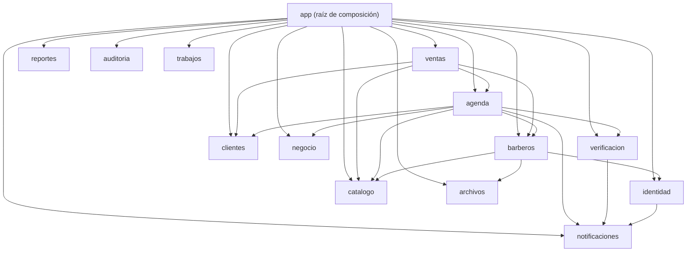
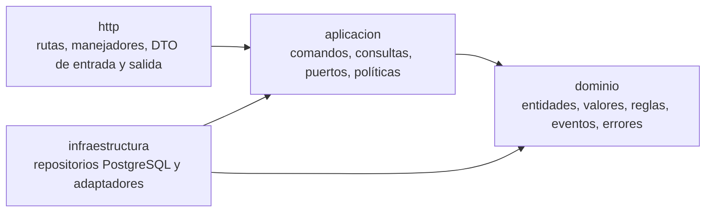

# Plan de desarrollo

**Proyecto**: Diamante Barbería · **Versión**: 1.0 (18/11/2026)

Documentos relacionados: [visión](documento-vision.md), [base de datos](diseno/base-de-datos.md), [API](diseno/api.md) y [pruebas E2E](diseno/pruebas-e2e.md).

---

## 1. Resumen

- **Monorepo**: backend (Rust + Axum), frontend (Astro + React), pruebas E2E (Playwright) e infraestructura en carpetas separadas de un mismo repositorio.
- **Arquitectura**: monolito modular. Un solo despliegue, dividido en **13 módulos de negocio casi independientes**, cada uno en su carpeta, con sus capas en subcarpetas y comunicándose con los demás solo por interfaces públicas. Cada módulo tiene además su propio esquema en PostgreSQL.
- **Despliegue**: Docker Compose desplegado con Dokploy (su Traefik da HTTPS y enruta el dominio): frontend, API, worker, migraciones, PostgreSQL 18, Gotenberg y respaldos (ADR 0007).
- **Fases**: 0 a 7 hasta el MVP (requisitos Must), más dos entregas posteriores (Should y Could). Estimación inicial: unas 17 semanas hasta el MVP con dos personas, a recalibrar al cerrar la fase 1.

---

## 2. Qué se toma del proyecto de referencia y qué se mejora

Se revisó [VictorStore-Back](https://github.com/CokeinsZ/VictorStore-Back) (NestJS). Su mayor acierto es la **separación por funcionalidad**: cada carpeta (`orders/`, `products/`, `users/`…) agrupa su controlador, su servicio, sus DTO (`dtos/`) y sus interfaces (`interfaces/`), y lo transversal vive aparte en `tools/` (guards, decoradores, estrategias y *abilities* por rol). Este proyecto conserva esa idea y la lleva más lejos:

| En VictorStore-Back | En Diamante Barbería |
|---|---|
| ✔ Una carpeta por funcionalidad | Se conserva y se refuerza: cada módulo es un **crate de Rust**, y el compilador impide usar lo que el módulo no publica. |
| ✔ Lo transversal separado en `tools/` | Se conserva: los crates `nucleo`, `contratos` y `plataforma`, con responsabilidades distintas. |
| ✔ Seguro por defecto: todo exige autenticación salvo lo marcado `@Public` | Se conserva: el enrutador exige sesión salvo en `/publico`, `/auth` y `/webhooks`. |
| ✔ Permisos por rol con `AbilityFactory` (acción × recurso) | Se conserva la idea como **políticas por caso de uso** en la capa de aplicación de cada módulo. |
| Los repositorios de todos los módulos viven juntos en `database/repositories/`, y un `RepositoriesModule` los conoce a todos | Cada módulo tiene sus propios repositorios en su carpeta `infraestructura/`. No hay un módulo global de repositorios. |
| Los servicios dependen de clases concretas (`OrdersRepository`) | Los casos de uso dependen de **puertos** (traits); las implementaciones se inyectan en la raíz de composición (inversión de dependencias). |
| La lógica de negocio vive en los servicios (por ejemplo, calcular el total consultando cada producto en un ciclo) | Entidades de dominio con sus reglas e invariantes; los cálculos agregados se hacen en SQL. |
| Crear una orden son tres escrituras separadas, sin transacción | Cada comando es una **unidad de trabajo** en una transacción, y las reglas críticas también las protege la base de datos. |
| El total de la orden se guarda aparte | Los derivados se calculan (vista `ventas.v_venta`). |
| Los controladores repiten la verificación de propiedad (`req.user.id != order.user_id`) | La política del caso de uso fija el alcance: un barbero solo puede tocar lo suyo, sin repetirlo en cada ruta. |
| Los servicios lanzan excepciones HTTP | Errores de dominio tipados; solo la capa HTTP los traduce a respuestas (*Problem Details*). |
| Interfaces y DTO se importan entre sí en círculo | Dependencias en una sola dirección (`http → aplicacion → dominio`), verificadas por el compilador. |
| Un script SQL único, con triggers para borrar en cascada y borrado físico | Migraciones versionadas por módulo, llaves foráneas con la acción correcta y borrado lógico. |
| Una contraseña escrita en `start.sh` y un certificado autofirmado generado dentro del contenedor de la app | Secretos fuera del repositorio (variables de entorno) y HTTPS con certificados automáticos en el proxy (Traefik de Dokploy). |
| El prefijo de la ruta (`vs/api/v1/...`) se repite en cada controlador | `/api/v1` se define una sola vez en la raíz de composición. |
| `console.log` de depuración | Logs estructurados con `tracing`. |
| Sin pruebas más allá de la plantilla | Pirámide de pruebas: unitarias, de integración y E2E. |

---

## 3. Arquitectura

### 3.1 Módulos del backend

| Módulo | Responsabilidad | Esquema de BD |
|---|---|---|
| `identidad` | Cuentas, sesiones, invitaciones, recuperación de contraseña y administradores | `identidad` |
| `negocio` | Datos de la barbería, días especiales, horario de atención calculado y políticas legales | `negocio` |
| `catalogo` | Servicios, combos y categorías | `catalogo` |
| `barberos` | Equipo, datos privados, horarios, ausencias, bloqueos, servicios ofrecidos y documentos | `barberos` |
| `clientes` | Clientes, autorizaciones, habeas data, segmentos y métricas | `clientes` |
| `verificacion` | Códigos por WhatsApp y comprobantes | `verificacion` |
| `agenda` | Disponibilidad, asignación de barbero, citas, enlaces de gestión y recordatorios | `agenda` |
| `ventas` | Ventas, pagos, descuentos, caja y cierres | `ventas` |
| `reportes` | Dashboard, reportes, liquidaciones, PDF y Excel (solo lectura) | — (lee vistas publicadas) |
| `notificaciones` | Cola de mensajes, WhatsApp Cloud API, correo, webhooks y avisos internos | `notificaciones` |
| `archivos` | Almacenamiento de fotos y documentos, y URL firmadas | `archivos` |
| `auditoria` | Registro de acciones sensibles | `auditoria` |
| `trabajos` | Cola de tareas y planificador del worker | `trabajos` |

### 3.2 Dependencias entre módulos

Las flechas van del módulo que usa hacia el módulo usado. Cargo prohíbe los ciclos. Cuando dos módulos necesitan conocerse mutuamente, se rompe el ciclo con **eventos** (crate `contratos`) o con un **puerto** que se implementa en la raíz de composición.



Todos los módulos dependen además de `nucleo` (tipos compartidos), `contratos` (eventos) y `plataforma` (infraestructura técnica, solo desde sus capas externas), y de `auditoria` a través de su API. `reportes` no depende de ningún otro módulo: lee sus vistas publicadas.

Ejemplos de ciclos evitados:

- **Venta → cita «Atendida»**: `ventas` publica `VentaRegistrada` y `agenda` se suscribe, así `agenda` no depende de `ventas`.
- **Métricas de clientes**: `clientes` se suscribe a `VentaRegistrada`, `VentaAnulada` e `InasistenciaMarcada`. Para recalcularlas usa el puerto `ConsultaVentasDeCliente`, definido en `clientes` e implementado en `app` con la API de `ventas`.

### 3.3 Capas dentro de cada módulo (arquitectura hexagonal)



| Capa | Contiene | Puede depender de | No puede |
|---|---|---|---|
| `dominio` | Entidades con invariantes, objetos de valor, máquinas de estado, reglas, eventos y errores del dominio | `nucleo` | Conocer SQL, HTTP, Axum, SQLx ni otros módulos |
| `aplicacion` | Un archivo por caso de uso (comandos y consultas), puertos (traits), políticas de autorización y DTO | `dominio`, `nucleo`, `contratos`, APIs de otros módulos | Conocer Axum o SQLx |
| `infraestructura` | Implementaciones de los puertos: repositorios con SQLx y adaptadores externos | `aplicacion`, `dominio`, `plataforma` | Exponer tipos de SQLx hacia afuera |
| `http` | Rutas, manejadores, extracción y validación de solicitudes, respuestas, documentación OpenAPI | `aplicacion`, `plataforma` | Contener reglas de negocio |

---

## 4. Estructura del monorepo

```text
diamante-barberia/
├── README.md
├── Makefile                          # atajos: make dev, make test, make e2e, make migrar
├── .env.example                      # todas las variables, sin valores secretos
├── .editorconfig
├── .gitignore
├── docker-compose.yml                # base (producción)
├── docker-compose.override.yml       # desarrollo (se carga solo, con recarga en caliente y Mailpit)
├── docker-compose.e2e.yml            # ambiente de pruebas E2E
├── backend/
├── frontend/
├── e2e/
├── infra/
├── docs/
│   ├── documento-vision.md
│   ├── plan-de-desarrollo.md
│   ├── diseno/                       # base de datos, API, pruebas E2E
│   └── decisiones/                   # ADR: 0001-monolito-modular.md, …
└── plataforma-barberia(1).html       # mockup de referencia
```

### 4.1 Backend

```text
backend/
├── Cargo.toml                        # workspace: lista de crates y versiones de dependencias compartidas
├── Cargo.lock
├── rust-toolchain.toml
├── clippy.toml
├── crates/
│   ├── nucleo/                       # tipos de dominio compartidos, sin infraestructura
│   │   └── src/
│   │       ├── lib.rs
│   │       ├── valores/              # Dinero, Porcentaje, Celular, Correo, RangoHorario, FechaOperacion
│   │       ├── identificadores.rs    # IdBarbero, IdCita… (newtypes)
│   │       ├── reloj.rs              # trait Reloj (sistema / controlado en pruebas)
│   │       ├── eventos.rs            # trait EventoDominio y bus de eventos
│   │       ├── actor.rs              # quién ejecuta: cliente, barbero, administrador, sistema
│   │       └── errores.rs
│   ├── contratos/                    # lenguaje publicado entre módulos
│   │   └── src/
│   │       ├── lib.rs
│   │       ├── agenda/eventos.rs     # CitaCreada, InasistenciaMarcada…
│   │       ├── ventas/eventos.rs     # VentaRegistrada, VentaAnulada
│   │       ├── barberos/eventos.rs   # HorarioCambiado, AusenciaRegistrada, BarberoRetirado
│   │       └── notificaciones/eventos.rs
│   ├── plataforma/                   # infraestructura técnica compartida
│   │   ├── migraciones/              # base compartida: extensiones y esquema `nucleo`
│   │   └── src/
│   │       ├── lib.rs
│   │       ├── configuracion/        # carga y validación de variables de entorno
│   │       ├── base_datos/           # pool, unidad de trabajo, migrador combinado
│   │       ├── http/                 # errores → Problem Details, extractores, sesión, CSRF, límites de uso
│   │       ├── seguridad/            # Argon2id, HMAC, AES-GCM, tokens
│   │       └── telemetria/           # tracing, id de solicitud
│   └── app/                          # raíz de composición: el único crate que conoce a todos
│       └── src/
│           ├── main.rs               # subcomandos: api | worker | migrar
│           ├── composicion.rs        # construye adaptadores e inyecta dependencias en los módulos
│           ├── enrutador.rs          # monta /api/v1 con las rutas de cada módulo
│           ├── suscripciones.rs      # conecta eventos con sus manejadores
│           ├── tareas.rs             # tareas programadas del worker
│           └── pruebas_e2e.rs        # endpoints /_pruebas (feature "pruebas-e2e")
├── scripts/
│   ├── verificar-esquema.sh          # migraciones = esquema de diseño + 27 pruebas
│   └── estructurar-modulo.sh         # crea las capas de un módulo como en `negocio`
└── modulos/
    ├── identidad/
    ├── negocio/
    ├── catalogo/
    ├── barberos/
    ├── clientes/
    ├── verificacion/
    ├── agenda/
    ├── ventas/
    ├── reportes/
    ├── notificaciones/
    ├── archivos/
    ├── auditoria/
    └── trabajos/
```

**Estructura interna de un módulo** (ejemplo completo: `agenda`). Todos los módulos siguen la misma plantilla.

```text
modulos/agenda/
├── Cargo.toml
├── README.md                          # qué hace, qué publica, de qué depende y qué eventos usa
├── migraciones/                       # solo SQL del esquema `agenda`
│   ├── 20261201000600_agenda__crear_esquema.sql
│   └── 20261201000610_agenda__vistas_publicadas.sql
├── src/
│   ├── lib.rs                         # publica solo `api` y `modulo`; todo lo demás es pub(crate)
│   ├── api.rs                         # fachada: DTO y traits que otros módulos pueden usar
│   ├── modulo.rs                      # recibe dependencias y entrega rutas + manejadores de eventos
│   ├── dominio/
│   │   ├── mod.rs
│   │   ├── entidades/
│   │   │   ├── cita.rs                # agregado Cita: transiciones de estado válidas
│   │   │   └── configuracion_agenda.rs
│   │   ├── valores/
│   │   │   ├── estado_cita.rs         # máquina de estados (patrón State)
│   │   │   ├── origen_cita.rs
│   │   │   └── franja_libre.rs
│   │   ├── reglas/                    # reglas de disponibilidad componibles (Specification)
│   │   │   ├── anticipacion_minima.rs
│   │   │   ├── ventana_reserva.rs
│   │   │   ├── dias_especiales.rs
│   │   │   ├── ausencias_y_bloqueos.rs
│   │   │   └── politica_inasistencias.rs
│   │   ├── servicios/
│   │   │   ├── motor_disponibilidad.rs
│   │   │   └── asignacion/            # estrategias de «Cualquier barbero» (Strategy)
│   │   │       ├── mod.rs
│   │   │       └── primero_disponible.rs
│   │   ├── eventos.rs
│   │   └── errores.rs
│   ├── aplicacion/
│   │   ├── mod.rs
│   │   ├── puertos/                   # traits pequeños, uno por necesidad
│   │   │   ├── repositorio_citas.rs
│   │   │   ├── fuente_horarios.rs     # lo implementa un adaptador sobre la API de `barberos`
│   │   │   ├── fuente_catalogo.rs
│   │   │   ├── directorio_clientes.rs
│   │   │   ├── validador_comprobantes.rs
│   │   │   └── notificador.rs
│   │   ├── comandos/                  # un archivo por caso de uso
│   │   │   ├── crear_cita_en_linea.rs
│   │   │   ├── crear_cita_personal.rs
│   │   │   ├── reprogramar_cita.rs
│   │   │   ├── cancelar_cita.rs
│   │   │   ├── confirmar_cita.rs
│   │   │   ├── iniciar_atencion.rs
│   │   │   ├── marcar_inasistencia.rs
│   │   │   └── reasignar_citas.rs
│   │   ├── consultas/
│   │   │   ├── disponibilidad.rs
│   │   │   ├── tablero_dia.rs
│   │   │   ├── citas_de_barbero.rs
│   │   │   ├── detalle_cita.rs
│   │   │   └── conflictos.rs
│   │   ├── manejadores_eventos/
│   │   │   ├── al_registrar_venta.rs
│   │   │   ├── al_recibir_respuesta_whatsapp.rs
│   │   │   └── al_cambiar_horario.rs
│   │   ├── tareas/
│   │   │   └── programar_recordatorios.rs
│   │   ├── politicas.rs               # quién puede ejecutar cada caso de uso
│   │   └── dto.rs
│   ├── infraestructura/
│   │   ├── mod.rs
│   │   └── postgres/
│   │       ├── repositorio_citas_pg.rs
│   │       ├── consultas_pg.rs
│   │       └── filas.rs               # mapeo fila ↔ dominio (SQLx no sale de aquí)
│   └── http/
│       ├── mod.rs
│       ├── rutas.rs
│       ├── manejadores/
│       │   ├── publico.rs
│       │   ├── panel.rs
│       │   └── barbero.rs
│       ├── solicitudes.rs
│       ├── respuestas.rs
│       └── openapi.rs
└── tests/                              # convención de Cargo
    ├── dominio_disponibilidad.rs       # reglas puras, sin base de datos
    ├── comandos_con_dobles.rs          # casos de uso con repositorios en memoria
    └── integracion_postgres.rs         # repositorios y restricciones con PostgreSQL real
```

### 4.2 Frontend

```text
frontend/
├── package.json
├── astro.config.mjs                  # adaptador Node (standalone) + integración de React
├── tsconfig.json                     # alias @modulos/*, @compartido/*
├── eslint.config.js                  # incluye las reglas de fronteras entre módulos
├── public/                           # favicon y tipografías autoalojadas
└── src/
    ├── pages/                        # rutas de Astro: archivos delgados, sin lógica
    │   ├── index.astro               # landing (servidor + caché corta)
    │   ├── agendar/index.astro
    │   ├── agendar/confirmada.astro
    │   ├── cita/[token].astro        # gestión de la cita por enlace
    │   ├── acceso/index.astro
    │   ├── acceso/activar.astro
    │   ├── acceso/recuperar.astro
    │   ├── legal/[documento].astro   # prerenderizadas
    │   ├── admin/[...ruta].astro     # monta la app del panel del administrador
    │   ├── barbero/[...ruta].astro   # monta la app del panel del barbero
    │   └── salud.ts
    ├── layouts/
    │   ├── SitioPublico.astro
    │   └── Panel.astro
    ├── modulos/                      # un módulo por funcionalidad
    │   ├── landing/
    │   ├── agendamiento/
    │   ├── gestion-cita/
    │   ├── acceso/
    │   ├── panel/                    # cascarón: menú lateral, barra inferior, enrutador, sesión
    │   ├── dashboard/
    │   ├── agenda/
    │   ├── barberos/
    │   ├── servicios/
    │   ├── clientes/
    │   ├── ventas/
    │   ├── reportes/
    │   ├── configuracion/
    │   ├── mis-citas/
    │   ├── mis-ventas/
    │   ├── mi-reporte/
    │   └── mi-perfil/
    └── compartido/
        ├── ui/                       # sistema de diseño del mockup: Boton, Chip, Segmentado, Interruptor,
        │                             # Campo, Modal, HojaInferior, Toast, Insignia, Avatar, Tarjeta…
        ├── estilos/                  # tokens.css (colores, tipografías, espaciados) y base.css
        ├── api/                      # cliente HTTP tipado, tipos generados de OpenAPI, errores
        ├── formato/                  # $35.000, 9:00 a. m., «lunes 3 de noviembre», celular
        ├── hooks/
        └── iconos/
```

**Estructura interna de un módulo del frontend** (ejemplo: `agenda`):

```text
modulos/agenda/
├── index.ts               # API pública del módulo: lo único que otros archivos pueden importar
├── rutas.tsx              # rutas del módulo dentro del panel
├── componentes/           # presentación pura: reciben props, no llaman a la API
│   ├── TableroDia.tsx
│   ├── BloqueCita.tsx
│   ├── ListaCitas.tsx
│   └── DetalleCita.tsx
├── contenedores/          # conectan componentes con datos y acciones
│   └── PaginaAgenda.tsx
├── hooks/                 # useTablero, useCancelarCita, useReprogramarCita…
├── api/                   # llamadas tipadas y claves de caché de TanStack Query
├── estado/                # estado local de la interfaz (vista día o lista, filtros)
├── esquemas/              # validaciones de formularios con Zod
├── tipos/
├── utilidades/
└── pruebas/               # Vitest + Testing Library
```

Tecnologías del frontend: Astro con `@astrojs/node` y `@astrojs/react`; React Router (modo librería) para los paneles; TanStack Query para el estado del servidor; React Hook Form + Zod para los formularios; `openapi-typescript` + `openapi-fetch` para el cliente tipado; `date-fns` con zona horaria e `Intl` para los formatos; gráficas en SVG propio, como en el mockup.

### 4.3 Pruebas E2E

Estructura detallada en [pruebas-e2e.md](diseno/pruebas-e2e.md#4-organización-del-código-de-pruebas): `e2e/pruebas/<modulo>/`, `e2e/paginas/` (Page Objects), `e2e/fixtures/` y `e2e/utilidades/`.

### 4.4 Infraestructura

```text
infra/
├── docker/
│   ├── backend.Dockerfile            # multietapa: compila con caché de dependencias → imagen mínima
│   ├── frontend.Dockerfile           # multietapa: build de Astro → Node en modo standalone
│   └── respaldo.Dockerfile           # PostgreSQL 18 + rclone + scripts
├── postgres/
│   └── init/00-roles.sh              # roles diamante_app y diamante_respaldo (el propietario lo crea la imagen)
└── respaldo/
    ├── respaldar.sh                  # pg_dump cada hora y diario + archivos + copia externa cifrada + retención
    └── restaurar.sh
```

---

## 5. Reglas de modularidad (obligatorias)

1. **Un módulo, una carpeta.** Todo lo de un módulo vive en su carpeta: dominio, casos de uso, repositorios, rutas, migraciones, pruebas y README. Si un cambio de negocio obliga a tocar varios módulos, es una señal para revisar los límites.
2. **Capas en subcarpetas y dependencias en una sola dirección**: `http → aplicacion → dominio` e `infraestructura → aplicacion/dominio`. El dominio no conoce frameworks ni la base de datos.
3. **Interfaz pública mínima.** En el backend, cada crate expone solo `api` y `modulo`, y el resto es `pub(crate)`, así que el compilador impide usar el interior de otro módulo. En el frontend, cada módulo exporta solo desde `index.ts`, y ESLint (`eslint-plugin-boundaries`) rechaza las importaciones internas entre módulos.
4. **Cada módulo es dueño de sus datos.** Solo él escribe en su esquema de PostgreSQL. Los demás usan su API o, en el caso de `reportes`, sus vistas publicadas `v_`.
5. **Sin ciclos.** Cargo los impide. Un ciclo se resuelve con un evento (`contratos`) o con un puerto implementado en `app`.
6. **Un caso de uso por archivo**, con su política de autorización, su validación y su transacción.
7. **Lo compartido es poco y estable.** `nucleo` contiene solo tipos de dominio genéricos (dinero, celular, reloj, eventos); `plataforma`, solo infraestructura técnica. Si algo solo lo usa un módulo, vive en ese módulo.
8. **La raíz de composición es la única que conoce todo.** `app` construye los adaptadores, los inyecta y registra rutas, eventos y tareas; ningún módulo instancia sus propias dependencias.
9. **Las pruebas viven con su módulo**: unitarias junto al código, de integración en `tests/` del crate.
10. **La documentación del módulo vive con el módulo**: su README dice qué publica, de qué depende y qué eventos emite y consume.

El CI verifica estas reglas: compila cada crate por separado, ejecuta las reglas de fronteras de ESLint y aplica todas las migraciones sobre una base vacía.

---

## 6. Principios SOLID y patrones de diseño

### 6.1 SOLID aplicado

| Principio | Aplicación concreta |
|---|---|
| **S** — Responsabilidad única | Un caso de uso por archivo (`cancelar_cita.rs`); los repositorios solo persisten; los manejadores HTTP solo traducen entre HTTP y aplicación; los componentes de React presentan y los contenedores obtienen datos. |
| **O** — Abierto/cerrado | Para agregar una estrategia de asignación de barbero, un canal de notificación o una regla de disponibilidad se crea una implementación nueva del trait, sin tocar los casos de uso. |
| **L** — Sustitución de Liskov | Cualquier implementación de `RepositorioCitas` (PostgreSQL o en memoria) cumple el mismo contrato; las pruebas de los comandos usan las versiones en memoria. |
| **I** — Segregación de interfaces | Puertos pequeños por necesidad (`FuenteHorarios`, `DirectorioClientes`, `Notificador`) en lugar de un repositorio gigante; módulos del frontend con un `index.ts` mínimo. |
| **D** — Inversión de dependencias | La aplicación depende de traits; la infraestructura los implementa y `app` los conecta. La misma técnica rompe los ciclos entre módulos. |

### 6.2 Patrones

| Patrón | Dónde |
|---|---|
| Arquitectura hexagonal (puertos y adaptadores) | Estructura de cada módulo del backend. |
| Monolito modular | Organización general: módulos con límites claros y un solo despliegue. |
| Repositorio | `infraestructura/postgres/` de cada módulo. |
| Unidad de trabajo | Cada comando se ejecuta en una transacción que reciben los repositorios y los manejadores de eventos síncronos. |
| CQRS ligero | Comandos (cambian estado, con reglas de dominio) separados de consultas (leen con SQL optimizado y vistas). |
| Eventos de dominio + Observer | Bus de eventos en proceso (`nucleo`), con suscripciones registradas en `app`. |
| Outbox | `notificaciones.mensaje`: el mensaje se encola en la misma transacción del hecho y lo envía el worker. |
| State | Máquina de estados de la cita (`estado_cita.rs`): solo las transiciones válidas compilan en métodos del agregado. |
| Strategy | Asignación de «Cualquier barbero» (`primero_disponible.rs`, DA-03), canales de notificación (WhatsApp, correo) y almacenamiento de archivos. |
| Specification | Reglas de disponibilidad componibles (anticipación, ventana, días especiales, ausencias y bloqueos). |
| Factory | Constructores que validan invariantes y devuelven `Result` (`Venta::registrar(...)`, `Cita::reservar(...)`). |
| Facade | `api.rs` de cada módulo. |
| Adapter | WhatsApp Cloud API de Meta, SMTP, Gotenberg y sistema de archivos, detrás de puertos. |
| Policy | Autorización por caso de uso (heredera del `AbilityFactory` del proyecto de referencia). |
| Newtype | Identificadores y valores (`IdCita`, `Dinero`, `Celular`) para que el compilador impida mezclarlos. |
| Builder | Datos de prueba legibles (`CitaDePrueba::nueva().con_barbero(…)`). |
| Page Object | Pruebas E2E. |
| Contenedor/presentación | Componentes de React. |

### 6.3 Buenas prácticas

- **Errores**: `thiserror` por capa; nunca `unwrap` fuera de las pruebas; la capa HTTP traduce cada error a *Problem Details* con un `codigo` estable.
- **Validación**: en el borde (DTO de entrada) y en el dominio (invariantes); la base de datos es la última defensa.
- **Configuración**: variables de entorno validadas al arrancar; el proceso no inicia si falta alguna.
- **Tiempo**: siempre a través del trait `Reloj`; nada llama a `Utc::now()` directamente.
- **Dinero**: tipo `Dinero` (entero en pesos) con operaciones que no permiten negativos.
- **Seguridad**: Argon2id, sesiones en el servidor, `SameSite=Strict` + verificación de `Origin`, límites de uso, secretos solo en variables de entorno, cabeceras de seguridad en la API (y HTTPS en el Traefik de Dokploy).
- **Observabilidad**: `tracing` con un id por solicitud; ningún dato personal sensible en los logs.
- **Estilo**: `rustfmt` y `clippy -D warnings`; ESLint y Prettier en el frontend. Nombres del dominio en español, iguales en el código y en la base de datos.
- **Dependencias principales del backend**: `axum`, `tokio`, `tower-http`, `sqlx` (PostgreSQL), `serde`, `thiserror`, `tracing`, `utoipa`, `argon2`, `hmac` + `sha2`, `aes-gcm`, `chrono` + `chrono-tz`, `reqwest` (Meta y Gotenberg), `lettre` (SMTP), `askama` (plantillas HTML de los reportes), `rust_xlsxwriter`, `tower_governor` (límites de uso). Los puertos asíncronos usados como objetos dinámicos se declaran con `async-trait` mientras el lenguaje no lo resuelva de forma nativa.

---

## 7. Despliegue con Docker Compose

> **Cambio (21/11/2026, ADR 0007)**: en producción se despliega con **Dokploy**, cuyo Traefik termina HTTPS y enruta el dominio; el servicio `proxy` con Caddy y el `Caddyfile` de esta sección se retiraron. La API sirve `/media/publico/*` y envía HSTS. Lo vigente está en el [runbook](operacion/runbook.md); los esqueletos de abajo quedan como referencia del diseño original.

### 7.1 Servicios

| Servicio | Imagen | Función | Expuesto |
|---|---|---|---|
| ~~`proxy`~~ | ~~`caddy:2`~~ | Reemplazado por el Traefik de Dokploy (ADR 0007) | — |
| `frontend` | Propia (Node) | Astro en modo servidor | No |
| `migraciones` | Propia (backend) | `migrar`: aplica las migraciones y termina | No |
| `api` | Propia (backend) | `api`: servidor Axum | No |
| `worker` | Propia (backend) | `worker`: mensajes, recordatorios y tareas | No |
| `db` | `postgres:18` | Base de datos con volumen persistente | No |
| `gotenberg` | `gotenberg/gotenberg:8.40.0` | HTML → PDF | No |
| `respaldo` | Propia (PostgreSQL 18 + rclone) | Respaldos cada hora y diarios con copia externa cifrada | No |
| `mailpit` (solo desarrollo y E2E) | `axllent/mailpit` | Captura de correos | Solo en local |

La API y el worker usan **la misma imagen** con distinto comando: un solo build y el mismo código.

### 7.2 Esqueleto de `docker-compose.yml`

```yaml
name: diamante

x-backend: &backend
  build: { context: ., dockerfile: infra/docker/backend.Dockerfile }
  env_file: .env
  restart: unless-stopped

services:
  proxy:
    image: caddy:2
    ports: ["80:80", "443:443"]
    environment:
      DOMINIO: ${DOMINIO}
    volumes:
      - ./infra/caddy/Caddyfile:/etc/caddy/Caddyfile:ro
      - caddy_datos:/data
      - archivos:/srv/media:ro
    depends_on:
      frontend: { condition: service_healthy }
      api: { condition: service_healthy }
    restart: unless-stopped

  frontend:
    build: { context: ., dockerfile: infra/docker/frontend.Dockerfile }
    environment:
      API_INTERNA_URL: http://api:8080
    healthcheck:
      test: ["CMD", "wget", "-qO-", "http://localhost:4321/salud"]
      interval: 10s
      retries: 5
    restart: unless-stopped

  migraciones:
    <<: *backend
    command: ["migrar"]
    depends_on:
      db: { condition: service_healthy }
    restart: "no"

  api:
    <<: *backend
    command: ["api"]
    volumes: [archivos:/datos/archivos]
    depends_on:
      migraciones: { condition: service_completed_successfully }
      gotenberg: { condition: service_started }
    healthcheck:
      test: ["CMD", "/app/diamante", "salud"]
      interval: 10s
      retries: 5

  worker:
    <<: *backend
    command: ["worker"]
    depends_on:
      migraciones: { condition: service_completed_successfully }

  db:
    image: postgres:18
    environment:
      POSTGRES_DB: diamante
      POSTGRES_USER: diamante_propietario
      POSTGRES_PASSWORD: ${POSTGRES_PASSWORD}
    volumes:
      - db_datos:/var/lib/postgresql          # válido para la ruta de datos de la imagen 18
      - ./infra/postgres/init:/docker-entrypoint-initdb.d:ro
    healthcheck:
      test: ["CMD-SHELL", "pg_isready -U diamante_propietario -d diamante"]
      interval: 5s
      retries: 10
    restart: unless-stopped                    # sin "ports": no se expone fuera de Docker

  gotenberg:
    image: gotenberg/gotenberg:8
    restart: unless-stopped

  respaldo:
    build: { context: ., dockerfile: infra/docker/respaldo.Dockerfile }
    env_file: .env
    volumes:
      - respaldos:/respaldos
      - archivos:/datos/archivos:ro
    depends_on:
      db: { condition: service_healthy }
    restart: unless-stopped

volumes:
  db_datos:
  archivos:
  respaldos:
  caddy_datos:
```

### 7.3 Esqueleto del `Caddyfile` (retirado, ver ADR 0007)

```caddyfile
{$DOMINIO} {
    encode zstd gzip

    handle /api/* {
        reverse_proxy api:8080
    }

    handle_path /media/publico/* {
        root * /srv/media/publico
        file_server
    }

    handle {
        reverse_proxy frontend:4321
    }

    header {
        Strict-Transport-Security "max-age=31536000; includeSubDomains"
        X-Content-Type-Options "nosniff"
        Referrer-Policy "strict-origin-when-cross-origin"
        -Server
    }
}
```

### 7.4 Ambientes

| Ambiente | Cómo se levanta | Particularidades |
|---|---|---|
| Desarrollo | `docker compose up` (carga `docker-compose.override.yml`) | Recarga en caliente, Mailpit, WhatsApp simulado y puerto de PostgreSQL abierto solo en `127.0.0.1`. |
| Pruebas E2E | `docker compose -f docker-compose.yml -f docker-compose.e2e.yml up --wait` | Base de datos en memoria, feature `pruebas-e2e`, reloj controlable y caché corta. |
| *Staging* | Otro proyecto de Compose en el servidor, con subdominio propio | WhatsApp real con número de pruebas de Meta; datos ficticios. |
| Producción | Dokploy despliega `docker-compose.yml` desde la rama (ADR 0007) | Variables en Dokploy; HTTPS y dominios en su Traefik. |

Despliegue: Dokploy construye las imágenes en el servidor con cada *push* y ejecuta `docker compose up -d`; las migraciones corren solas antes de la API y una versión se revierte desplegando el commit anterior ([runbook](operacion/runbook.md)).

---

## 8. Plan por fases

La estimación supone **dos personas** y es preliminar: se recalibra con la velocidad real al cerrar la fase 1. Cada fase termina con algo usable y probado en el ambiente E2E.

| Fase | Objetivo | Módulos y entregables | Criterio de salida | Duración estimada |
|---|---|---|---|---|
| **0. Fundaciones** | Dejar listo el terreno para que cada módulo nazca con la estructura correcta | Monorepo; workspace de Cargo con `nucleo`, `contratos`, `plataforma` y `app`; **plantilla de módulo** (carpetas, README, `api.rs`, `modulo.rs`) y un módulo de ejemplo; migrador combinado por módulo; Docker Compose (desarrollo, E2E y base); Caddy; CI (formato, clippy, pruebas, ESLint, build de imágenes, migraciones sobre base vacía); proyecto Astro + React con los tokens del mockup y los componentes base de `compartido/ui`; proyecto Playwright; ADR iniciales. **Iniciar el trámite de WhatsApp Cloud API (DEP-01).** | `docker compose up` levanta todo y `/api/salud` responde; CI en verde; una prueba E2E de humo pasa. | 2 semanas |
| **1. Identidad, negocio y transversales** | Que el personal pueda entrar y la base del negocio exista | `identidad` (sesión, invitación, recuperación, políticas por rol), `negocio` (datos, días especiales), `auditoria`, `archivos`; frontend: acceso, cascarón del panel (menú, barra inferior, rutas protegidas) y configuración básica. | E2E-AUT-01 a 05 en verde. | 2 semanas |
| **2. Catálogo y equipo** | Cargar servicios, combos y barberos | `catalogo` (servicios y combos), `barberos` (registro, horario, servicios, estados por fecha, ausencias, bloqueos, visibilidad, foto); pantallas de servicios, barberos y «Mi perfil» básico. | E2E-BAR-01, 03, 04, 06 y E2E-SER-01 a 03 en verde. | 2 semanas |
| **3. Agenda y agendamiento** | El corazón del producto: reservar sin cruces | Motor de disponibilidad con pruebas unitarias exhaustivas; `clientes` (registro y búsqueda); `verificacion` (con WhatsApp simulado); `agenda` (crear, reprogramar, cancelar, inasistencia, tablero, conflictos); landing con datos reales y caché; flujo público de reserva, confirmación y gestión por enlace. | E2E-PUB-01 a 04, E2E-RES-01 a 09 y E2E-AGE-01 a 05 en verde. | 3 semanas |
| **4. Notificaciones y worker** | Mensajes reales y recordatorios | `notificaciones` (cola de salida, adaptador de WhatsApp Cloud API, plantillas, webhooks firmados, correo SMTP, avisos internos) y `trabajos` (cola, planificador, recordatorios, mantenimiento); pruebas con Meta en *staging*. | E2E-NOT-01, 03, 04 en verde; mensajes reales verificados en *staging*. | 2 semanas |
| **5. Ventas y caja** | Cobrar y cuadrar | `ventas` (registro desde cita o sin cita, descuentos, propina libre, pagos, anulación, caja del día); proyección de métricas en `clientes`; panel del barbero («Mis citas» y «Mis ventas»). | E2E-VEN-01 a 05, E2E-CLI-01, 02, 04 y E2E-AGE-06 en verde. | 2 semanas |
| **6. Reportes y dashboard** | Información para decidir y liquidar | `reportes` (resumen, detallado con liquidación, PDF con Gotenberg) y la parte Must del dashboard. | E2E-REP-01 a 04 en verde; reportes validados por el contador. | 2 semanas |
| **7. Endurecimiento y salida** | Producción segura y estable | Revisión de seguridad (OWASP ASVS nivel 1), rendimiento (metas RNF-REN), accesibilidad (axe y teclado), suite E2E completa en los tres navegadores, respaldo y **restauración probada**, contenido real y textos legales, despliegue en el VPS, capacitación del equipo. | Todos los requisitos Must cumplidos; cero pruebas inestables; aceptación de la barbería. **MVP en producción.** | 2 semanas |
| **8. Entrega 2 (Should)** | Profesionalizar la operación | Dashboard completo, confirmación con un toque, reprogramación por enlace, autogestión completa del barbero, cierre de caja, segmentos configurables, alertas y avisos. | Requisitos Should cumplidos con sus pruebas. | Según la priorización |
| **9. Entrega 3 (Could)** | Comodidades | Mapa de calor, comparativo anual, exportaciones a Excel, pagos combinados, solicitudes de corrección, control de la PILA, segundo factor para administradores. | Según el valor observado en producción. | Según la priorización |

**Total hasta el MVP: unas 17 semanas** (fases 0 a 7).

### 8.1 Avance

| Fase | Parte | Estado (21/11/2026) |
|---|---|---|
| 0 | **Base de datos** | ✅ Esquema completo dividido en migraciones por módulo (13 archivos + base compartida). `backend/scripts/verificar-esquema.sh` comprueba que son idénticas a `docs/diseno/esquema.sql` y que pasan las 27 pruebas de reglas de negocio. |
| 0 | **Backend** | ✅ Workspace con `nucleo`, `contratos`, `plataforma` y `app`; 12 módulos con su esqueleto y sus migraciones; módulo de referencia `negocio` completo (dominio, casos de uso, PostgreSQL, HTTP y pruebas); binario `diamante api \| worker \| migrar \| salud`. |
| 0 | **Infraestructura del backend** | ✅ Dockerfile (sin BuildKit, ADR 0004), Docker Compose base, de desarrollo y de E2E, rol `diamante_app` sin DDL, la integración continua quedó a cargo del equipo (el archivo de CI se retiró el 21/11/2026). |
| 0 | Frontend y Playwright | ⏳ Pendiente. (Caddy se descartó: ADR 0007.) |
| 1 | **Backend** | ✅ `identidad` completo (sesión con cookie, bloqueo por intentos, invitación, recuperación, cambio de contraseña, administradores, límites de intentos y validación de sesión en cada petición); `auditoria` (registro dentro de la transacción de cada módulo y `GET /auditoria`); `negocio` ahora audita sus cambios; correo de `notificaciones` adelantado de la fase 4 (cola *outbox*, SMTP con reintentos, Mailpit); adaptador de `barberos` para saber si un barbero puede entrar. `app`: sesiones reales, verificación de `Origin`, IP del cliente, `diamante crear-administrador` y worker que envía correos. Patrón de contexto transaccional en ADR 0005. 101 pruebas (unitarias, de integración con PostgreSQL y de cableado completo). |
| 1 | Módulo `archivos` y resto de `negocio` | ✅ `archivos`: almacenamiento en el volumen, tipo detectado por el contenido, fotos públicas en `/media/publico` y documentos privados con URL firmadas (HMAC, 5 minutos). `negocio`: edición de días especiales, precarga idempotente de los festivos de Colombia (Ley Emiliani y Pascua), horario de atención calculado con las franjas de los barberos y versiones de las políticas legales. |
| 2 | **Backend** | ✅ `catalogo` (servicios y combos, nombre único sin tildes ni mayúsculas, estado, componentes, barberos que lo ofrecen) y `barberos` (registro con cuenta e invitación, edición, estado por fecha, visibilidad y acceso al panel, orden del equipo, retiro, horario, servicios, ausencias con soporte, bloqueos, foto, documentos con expediente y datos privados cifrados con AES-256-GCM, «Mi perfil» en `/yo`). Eventos `HorarioCambiado`, `BloqueoCreado`, `AusenciaRegistrada` y `AccesoRevocado` publicados en el bus para la fase 3. 149 pruebas. |
| 2 | Pendiente para la fase 3 | ✅ Las citas afectadas antes de guardar una ausencia, un bloqueo o un horario se consultan con `POST /agenda/conflictos` (RF-BAR-13, RF-PBA-09). El aviso al administrador (RF-BAR-14) pasa a la fase 4 con los avisos internos. La aparición en la landing y en el agendamiento de E2E-BAR-01 y E2E-SER-01 ya funciona en la API; falta verla en las pantallas. |
| 3 | **Backend** | ✅ Motor de disponibilidad puro con sus pruebas (anticipación, ventana, intervalo, festivos con franjas de domingo, días cerrados, cierre temprano, ausencias, retiro, bloqueos, citas, «Cualquier barbero» y calendario con últimos cupos). `clientes` (registro en línea con autorización de datos, registro desde el panel, búsqueda rápida, listado con segmentos, ficha y proyección de inasistencias). `verificacion` (código HMAC de 4 dígitos, 5 intentos, espera de reenvío, comprobante de un solo uso; WhatsApp simulado en la cola y `GET /_pruebas/mensajes` solo con `DIAMANTE_PRUEBAS_E2E=true` fuera de producción). `agenda`: landing con datos reales y caché de 60 s, servicios y barberos agendables, calendario y horas, reserva en una sola transacción con `409 conflicto_horario` y alternativas, gestión por enlace (ver, cancelar —tardía según el aviso—, reprogramar y recordatorios), tablero, citas del panel (crear, reprogramar o reasignar, cancelar con motivo, confirmar, iniciar e inasistencia), conflictos, pendientes de cierre y configuración auditada. Prueba de cableado completo que recorre E2E-PUB-01/02/04, E2E-RES-01…03 y 05…09 y E2E-AGE-01…05 sobre la API. 170 pruebas. |
| 3 | Pendiente | ✅ Recordatorios (fase 4). El archivo `.ics` se descartó (DA-18): solo Google Calendar. Quedan las pantallas y sus escenarios en Playwright. |
| 4 | **Backend** | ✅ `notificaciones`: WhatsApp con plantillas (`docs/diseno/plantillas-whatsapp.md`), reintentos (1, 2, 4, 8 min) y aviso a la administradora cuando un mensaje de una cita no se entrega; **adaptador simulado** mientras no haya credenciales de Meta (fuera de producción; en producción los mensajes esperan en la cola); webhook firmado (`X-Hub-Signature-256`, verificación del token de Meta) con estados de entrega que solo avanzan y botones «Confirmo» / «Cancelar cita»; avisos internos y registro de mensajes. `trabajos`: cola con `SKIP LOCKED`, planificador idempotente por franja, reintentos y recuperación de abandonados; recordatorios de 24 h y 2 h cada 5 minutos y mantenimiento nocturno. `agenda`: recordatorio manual, estado de los mensajes en el detalle, avisos por cambios de horario, bloqueos o ausencias con citas, reasignación en lote y aviso para reprogramar. Ambiente E2E con reloj de pruebas (`/_pruebas/reloj`), pasada del worker a demanda (`/_pruebas/trabajos/ejecutar`) y worker dentro de la API. E2E-NOT-01 a 04 cubiertos por una prueba de cableado completo. |
| 4 | Pendiente | Adaptador real de WhatsApp Cloud API y pruebas con Meta en *staging* (cuando las plantillas estén aprobadas). Alertas de la cola (RNF-OBS-02). |
| 5 | **Backend** | ✅ `ventas`: registro desde la cita o sin cita (cliente registrado, nuevo u ocasional), ticket consecutivo sin huecos, descuentos con motivo (el barbero solo los permitidos), propina libre, pagos que cuadran (uno o dos métodos), comisión con el porcentaje vigente copiado, anulación auditada, caja del día, «Lo que llevas hoy», cierre de caja con diferencia y métodos de pago. La cita queda «Atendida» y la ficha del cliente suma visita, gasto, última visita, barbero habitual y ticket promedio (eventos en la misma transacción). `clientes`: anonimización a petición del titular (con citas por atender, se rechaza) y solicitudes de habeas data con su plazo legal. E2E-VEN-01 a 06, E2E-CLI-01, 02, 04 y E2E-AGE-06 cubiertos por una prueba de cableado completo. 200 pruebas. |
| 5 | Pendiente | Pantallas del registro de venta, la caja y el panel del barbero, y sus escenarios en Playwright. Configuración de descuentos y motivos (RF-VEN-14, Could) y de los umbrales de segmentos (RF-CFG-08, entrega 2). |
| 6 | **Backend** | ✅ `reportes` (solo lectura de las vistas publicadas): dashboard del día con comparación a la misma hora de la semana anterior, tendencia de 12 días, citas por estado, rendimiento y ocupación por barbero (festivos, cierres y bloqueos incluidos) y ausentes; tendencias (por servicio, clientes del mes, año actual contra el anterior, horas pico); alertas (mañana sin confirmar, cumpleaños con 29 de febrero, ausentes, por reactivar, solicitudes del titular y avisos); resumen de ventas y servicios, liquidación por barbero con el porcentaje de cada venta («Mi reporte» para el barbero) y reporte de clientes, por mes o rango; PDF A4 con Gotenberg (encabezado con marca, tipo, periodo y fecha; pie con NIT y «Página X de Y»), auditados. Gotenberg sin JavaScript ni red. E2E-REP-01 a 04 cubiertos por una prueba de cableado completo con cifras exactas y una carpeta de 22 peticiones en la colección. |
| 6 | Pendiente | Validación de los reportes por el contador (criterio de salida); pantallas del dashboard y los reportes; exportación a Excel (RF-REP-07) y reporte por servicio (RF-SER-07), ambos *Could*. |
| 7 | **Backend** | ✅ Revisión OWASP ASVS nivel 1 ([docs/operacion/seguridad.md](operacion/seguridad.md)): cabeceras de seguridad, límites de uso por IP y por sesión, trazas con la plantilla de la ruta (sin tokens ni datos personales), vida máxima de las sesiones (30 días), matriz de autorización de todas las rutas, `cargo audit` sin vulnerabilidades. Concurrencia: dos pruebas con peticiones simultáneas reales (reservas, «Cualquier barbero», tiquetes, cobros, anulaciones y cierres dobles, métricas del cliente, transiciones de una cita, workers, bloqueo de cuentas); corrigió un `500` por bloqueo mutuo en las reservas (ahora las citas de un mismo barbero se guardan por turnos con un candado de transacción). Respaldos cada hora y diarios con archivos, manifiesto de filas, copia externa cifrada (rclone) y restauración probada de punta a punta ([runbook](operacion/runbook.md)). Despliegue con Dokploy y su Traefik (ADR 0007), verificado con un Traefik simulado: HTTPS, HSTS, enrutamiento de `/api` y `/media`, IP real del cliente, PDF y log de acceso sin rutas; la simulación corrigió dos fallas de producción (las migraciones exigían las claves de la API y el primer respaldo se hacía antes de migrar). Rendimiento con dos años de datos: todas las metas RNF-REN con márgenes de 10 a 100 veces ([informe](operacion/rendimiento.md)). Recorrido de la colección automatizado (`make coleccion`): 355 peticiones y 683 pruebas sin fallas. 230 pruebas en Rust. |
| 7 | Pendiente | Accesibilidad y suite E2E de Playwright (dependen del frontend), contenido real y textos legales, despliegue en el VPS, capacitación, revisión de contraseñas filtradas (V2.1.7) e integración continua (a cargo del equipo). |
| 1 | Frontend (acceso, cascarón del panel, configuración básica) y E2E-AUT-01 a 05 | ⏳ Pendiente (depende del frontend de la fase 0). |

Orden de construcción dentro de cada módulo: dominio y sus pruebas unitarias → casos de uso con dobles de prueba → repositorio PostgreSQL con pruebas de integración → rutas HTTP y OpenAPI → pantalla en el frontend → escenario E2E.

---

## 9. Definición de terminado

Una funcionalidad está terminada cuando:

1. Vive en su módulo y respeta las reglas de la sección 5 (el CI no reporta violaciones de fronteras).
2. Tiene pruebas unitarias del dominio y pruebas de integración de su caso de uso; si es un recorrido crítico, su escenario E2E está en verde.
3. Sus migraciones se aplican sobre una base vacía y sobre la versión anterior.
4. La especificación OpenAPI está actualizada y los tipos del frontend se regeneraron.
5. La pantalla funciona desde 320 px, con teclado y sin violaciones serias de axe.
6. Registra en la auditoría las acciones sensibles.
7. Pasó la revisión de código de otra persona y el CI está en verde (formato, clippy, ESLint, pruebas y build).
8. Su README de módulo y, si aplica, la documentación de diseño, están al día.

## 10. Flujo de trabajo

- **Ramas**: desarrollo basado en tronco con ramas cortas (`modulo/descripcion`, por ejemplo `agenda/reprogramar-cita`), integradas por pull request en uno o dos días.
- **Commits**: Conventional Commits (`feat(agenda): …`, `fix(ventas): …`), con el módulo como alcance.
- **Revisión**: toda integración pasa por pull request con CI en verde y una aprobación.
- **Decisiones**: cada decisión de arquitectura se registra como ADR en `docs/decisiones/` (contexto, decisión, consecuencias).
- **Versiones**: versionado semántico de las imágenes; cada entrega a producción lleva su etiqueta y sus notas.
